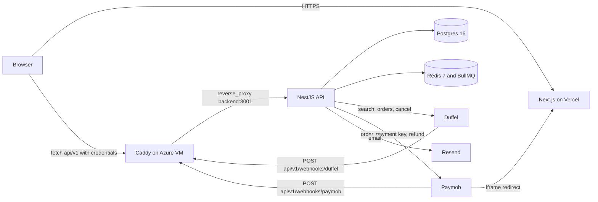

# TravelHub — Architecture

**Status:** Written from code 2026-10-27 (main @ b176f47)

This document describes what is deployed and why it is shaped that way, read from the code rather than from the plans in `docs/archive/`. It assumes you know web backends but not this repo. Every claim points at a file so you can jump to it. Where the code did not settle a question, there is a `> Note:`.

Companion documents: [api_contract.md](api_contract.md) (endpoint-by-endpoint contract, verified against the same commit), [booking_state_machine.md](booking_state_machine.md), [deployment.md](deployment.md), [TESTING.md](TESTING.md).

---

## 1. System topology

TravelHub is two deployables plus two datastores:

| Component | Where it runs | Source | Notes |
|---|---|---|---|
| Web app (Next.js 16, React 19) | Vercel, `www.safariyat.live` | `app/web` | Arabic-first, RTL. Talks to the API only through `NEXT_PUBLIC_API_URL`. |
| API (NestJS 11) | One Azure VM, Docker Compose, `api.safariyat.live` | `app/Backend` | HTTP server, BullMQ workers and cron sweeps all run in this one process. |
| Postgres 16 | Same VM, `postgres` container, `pgdata` volume | `docker-compose.prod.yml` | Not exposed on a host port. |
| Redis 7 | Same VM, `redis` container, `redisdata` volume | `docker-compose.prod.yml` | BullMQ queues, rate-limit windows, search cache, idempotency locks. |
| Caddy 2 | Same VM, ports 80/443 | `Caddyfile` | `{$DOMAIN} { reverse_proxy backend:3001 }` — automatic Let's Encrypt TLS, nothing else. |

External services: Duffel (flight search, orders, cancellations, webhooks), Paymob (card payments, refunds, webhooks), Resend (transactional email over its REST API — no SDK, see `app/Backend/src/auth/services/mail.service.ts`), Google OAuth, Sentry (both apps).

### Request flow

Points worth knowing:

- The browser calls the API directly (cross-origin), not through a Next.js proxy. CORS is pinned to `WEB_APP_URL` with `credentials: true` (`app/Backend/src/main.ts`), which is why the refresh cookie is `SameSite=None; Secure` in production (`app/Backend/src/auth/services/token.service.ts`).
- Everything under `/api/v1` is prefixed by `app.setGlobalPrefix('api/v1', { exclude: ['health'] })`. `GET /health` is unprefixed so the Docker healthcheck in `docker-compose.prod.yml` and external uptime monitors can hit it.
- Webhooks enter through the same Caddy → Nest path as user traffic. Both webhook receivers verify a signature before any database write, persist the event, enqueue a job, and return quickly (section 2.4).
- Paymob's card form is an iframe inside `/checkout/payment`. After payment, Paymob navigates the iframe to `/checkout/payment-return`, which breaks out of the frame with `window.top` back to `/checkout/payment` (`app/web/src/app/checkout/payment-return/page.tsx`). Payment *state* never comes from that redirect; it comes from the Paymob webhook.

### Build, deploy and runtime wiring

| Concern | Where | What it does |
|---|---|---|
| Backend image | `app/Backend/Dockerfile` | `node:22-alpine`, `npm ci` with devDependencies kept on purpose (the migration runner needs ts-node), `nest build`, then `CMD npm run migration:run && npm run start:prod`. Migrations run on every container start. |
| Production compose | `docker-compose.prod.yml` | Four services with healthchecks; `backend` waits for healthy Postgres/Redis; `DATABASE_URL`, `REDIS_URL`, `PORT` are injected by compose and override whatever is in `app/Backend/.env` (`env_file`). Root `.env` supplies `POSTGRES_PASSWORD` and `DOMAIN` (`.env.prod.example`). |
| Backend deploy | `.github/workflows/deploy-backend.yml` | On push to `main` touching `app/Backend/**`, the compose file, the Caddyfile or the workflow itself: runs lint, typecheck, build and `test:cov`, then SSHes to the VM (`appleboy/ssh-action`) and runs `git pull origin main && docker compose -f docker-compose.prod.yml up -d --build`. |
| CI | `.github/workflows/ci.yml` | Four jobs on PRs and pushes to `main`; see [TESTING.md](TESTING.md). |
| Web deploy | Vercel | No Vercel config lives in the repo; the Vercel Git integration builds `app/web` on push. `NEXT_PUBLIC_API_URL` and the Sentry variables are set in Vercel project settings ([deployment.md](deployment.md) §6, §9). |
| Backups | `scripts/backup-db.sh`, cron on the VM | `pg_dump` to `~/backups/postgres` on the same disk; off-site copy is a commented-out block ([deployment.md](deployment.md) §8). |
| Local datastores | `docker-compose.yml` | Postgres + Redis on host ports 5432/6379 for development and the backend e2e suite. |

> Note: there is one environment. No staging, and no separate worker process — the API container is also the queue consumer and the cron runner. If it is ever scaled to two replicas, every `@Cron` sweep in section 2.3 will run twice; nothing in the code elects a leader.

---

## 2. Backend module map

Entry points: `app/Backend/src/main.ts` (bootstrap: Sentry first import, structured logger, helmet, CORS, cookie-parser, 1 MB JSON limit, global `ValidationPipe({ whitelist, transform })`, `GlobalExceptionFilter`, `api/v1` prefix, shutdown hooks) and `app/Backend/src/app.module.ts` (Joi-validated config, `SentryModule`, `ScheduleModule`, `ThrottlerModule` 100 req/min/IP as a global `APP_GUARD`, `BullModule.forRootAsync` on `REDIS_URL`, `RequestIdMiddleware` on every route, and the feature modules below).

### 2.1 Modules

| Folder (`app/Backend/src/`) | Owns | Controllers (routes under `/api/v1`) | Main services | Entities | Queues / crons |
|---|---|---|---|---|---|
| `auth/` | Sign-in (Google OAuth + magic link), sessions, guards | `AuthController` — `GET auth/google`, `GET auth/google/callback`, `POST auth/magic-link/request` (202), `POST auth/magic-link/verify`, `POST auth/refresh`, `POST auth/logout`; `MeController` — `GET me` | `TokenService` (access JWT + refresh-token rotation with family revocation), `AccountResolutionService` (find-or-create under `FOR UPDATE`), `MagicLinkService` (Redis rate limits), `MailService` (Resend REST, console fallback; also sends booking-confirmation and schedule-change mail), `GoogleAuthService` (PKCE + HMAC-signed state), `MagicLinkTokenPurgeService` | `AuthIdentity`, `MagicLinkToken`, `RefreshToken` | Cron: purge expired magic-link tokens |
| `users/` | The `User` entity only (`UserRole` = `user` \| `technical_admin`). No module, no controller. | — | — | `User` | — |
| `flights/` | Public search | `FlightsController` — `GET flights/airports/search` (120/min), `GET flights/search` (30/min), `GET flights/offers/:offer_id` | `FlightsService`: per-IP sliding window in Redis, result cache `flight_search:cache:*` with TTL `min(120 s, soonest offer expiry)`, outbound Duffel token bucket `duffel_rate_limit:search` (capacity 100, refill 120/min) shared with `BookingsService` | — | — |
| `duffel/` | The only code that speaks Duffel's API | — | `DuffelService`: `search`, `fetchOffer`, `createOrder` (130 s timeout; 4xx → `DuffelDefinitiveError`, 5xx/timeout → `DuffelAmbiguousError`), `findOrder` (cursor scan that reports `complete: false` when it hit the page cap), `getOrder`, `cancelOrder` (quote + confirm), `verifyWebhookSignature` (HMAC-SHA256 over `t.rawBody`, timing-safe), `mapOrderResult`, `searchAirports`, `getMetrics`. Normalises every offer to `NormalizedOffer`: integer minor units, local wall-clock times plus IANA zone. | — | — |
| `bookings/` | The booking lifecycle: creation, passengers, fulfillment, cancellation, refunds, e-tickets, Duffel webhooks | `BookingsController` — `POST bookings` (optional `Idempotency-Key`), `PUT bookings/:id/passengers`, `GET bookings`, `GET bookings/:id`, `GET bookings/:id/cancellation-quote`, `POST bookings/:id/cancel`, `GET bookings/:id/documents`, `GET bookings/:id/ticket.pdf`; `DuffelWebhooksController` — `POST webhooks/duffel` | `BookingsService` (T1/T2/T7 + reads), `BookingStateMachineService`, `MarkupService`, `OrderFulfillmentService`, `FulfillmentOutcomeService`, `DuffelReconciliationService`, `RefundExecutionService`, `ExpirySweepService`, `DuffelWebhookSweepService`, `RefundRequeueSweepService`, `TicketPdfService` (pdfkit + qrcode, Noto Naskh Arabic from `app/Backend/assets/fonts`) | `Booking`, `FlightOfferSnapshot`, `Slice`, `Segment`, `Passenger`, `BookingStatusHistory`, `Document`, `SupplierWebhookEvent`, `MarkupRule` | Consumes `order_fulfillment_queue`, `duffel_webhook_queue`, `refund_execution_queue`; produces `duffel_webhook_queue`, `refund_execution_queue`. Crons: expiry sweep, Duffel webhook sweep, reconciliation, refund requeue |
| `payments/` | Paymob integration, payment attempts, payment webhooks, refund rows | `PaymentsController` — `POST bookings/:id/payment-intent`, `GET bookings/:id/payment`; `WebhooksController` — `POST webhooks/paymob` | `PaymentsService` (auth token → order → payment key → `iframe_url`), `PaymobService` (own `PaymobModule` so `bookings/` can import it without a cycle; HMAC-SHA512 verification; refund call), `PaymentWebhookSweepService`, `WebhookRetentionService` | `Payment`, `PaymentAttempt`, `PaymentWebhookEvent`, `Refund` | Consumes `payment_webhook_queue`; produces `payment_webhook_queue`, `order_fulfillment_queue`. Crons: payment webhook sweep, 90-day retention prune |
| `ledger/` | Append-only money ledger | `LedgerController` — `GET admin/ledger`, `GET admin/ledger/summary`, `POST admin/ledger/adjustment` (admin only) | `LedgerService.createEntry` takes the caller's `EntityManager` so entries commit with the state change that justifies them | `LedgerEntry` (`customer_payment`, `gateway_refund`, `supplier_charge`, `supplier_refund`, `adjustment`) | — |
| `admin/` | Operations console API | `AdminController` (all `technical_admin`, `@SkipThrottle`) — `GET/PATCH admin/users`, `GET admin/bookings`, `POST admin/bookings/:id/cancel`, `POST admin/payments/:id/refund`, `GET admin/refunds`, `POST admin/refunds/:id/retry`, `GET/POST/PATCH admin/markup-rules`, `GET admin/health/duffel`, `GET admin/metrics`, `GET admin/audit-logs` | `AdminService` (injects the three queues for backlog counts and retry), `AuditLogService` | `AuditLog` | Produces `refund_execution_queue` (retry) |
| `support/` | Customer support tickets | `SupportController` (JWT) — `POST/GET support/tickets`; `AdminSupportController` (admin, `@SkipThrottle`) — `GET admin/support/tickets`, `PATCH admin/support/tickets/:id` | `SupportService` | `SupportTicket` (PNR is free text on purpose, not a FK) | — |
| `health/` | Readiness probe | `HealthController` — `GET /health` (unprefixed): Terminus DB ping + Redis ping, 503 if either is down | — | — | — |
| `common/` | Cross-cutting HTTP concerns | — | `GlobalExceptionFilter` (`filters/`), `RequestIdMiddleware` (`middleware/`), `StructuredLoggerService`, `request-context.ts` (AsyncLocalStorage), `redact.ts` (`logging/`), `ErrorEnvelope`/`ErrorCode` (`dto/`) | — | — |
| `database/` | TypeORM wiring | — | `DatabaseModule` (`autoLoadEntities`, `synchronize: false`), `data-source.ts` for the migration CLI, `migrations/` (11 files, `1751600000000-InitAuthTables` → `1758000000000-CreateSupportTicketsTable`) | — | — |
| `redis/` | One shared ioredis client | — | `RedisModule` (global, exports `REDIS_CLIENT`, `quit()` on shutdown) | — | — |
| root | Scaffold | `AppController` — `GET /` returns the string `Hello World!` (leftover from `nest new`, kept because the e2e smoke asserts on it) | `AppService`, `instrument.ts` (Sentry init, must stay the first import in `main.ts`) | — | — |

### 2.2 Queues

All queues are BullMQ on the shared Redis. Job names and options come from the producers.

| Queue | Produced by | Consumed by | Job name | Retry policy |
|---|---|---|---|---|
| `payment_webhook_queue` | `payments/webhooks.controller.ts` (after persisting the event), `PaymentWebhookSweepService` | `payments/queues/payment-webhook.processor.ts` | `process_webhook` | None configured. The processor throws when the `PaymentAttempt` is not there yet (webhook raced the intent), which fails the job; the sweep re-enqueues it a minute later. |
| `order_fulfillment_queue` | `PaymentWebhookProcessor`, only after its transaction commits | `bookings/queues/order-fulfillment.processor.ts` | `create_duffel_order` | `attempts: 1`. The processor catches everything and never rethrows: an ambiguous Duffel outcome must stay `paid` for reconciliation, never be re-POSTed. |
| `duffel_webhook_queue` | `bookings/duffel-webhooks.controller.ts`, `DuffelWebhookSweepService` | `bookings/queues/duffel-webhook.processor.ts` | `process_duffel_webhook` | None. Events that cannot be matched to a local booking yet are left with `processed_at IS NULL` and re-enqueued by the sweep. |
| `refund_execution_queue` | `FulfillmentOutcomeService.enqueueRefund` (used by T6, customer self-cancel, the requeue sweep and admin retry) | `bookings/queues/refund-execution.processor.ts` | `execute_refund` | `jobId: refund:<id>`, 5 attempts, exponential backoff from 30 s, `removeOnFail`. The `failed` worker event marks the row `failed` after the last attempt (`bookings/queues/refund-execution.queue.ts`). |

### 2.3 Crons

All are `@Cron` from `@nestjs/schedule`, running inside the API container on its clock.

| Service | File | Schedule | Purpose |
|---|---|---|---|
| `ExpirySweepService` | `bookings/services/expiry-sweep.service.ts` | every minute | `pending` / `awaiting_payment` bookings whose `FlightOfferSnapshot.expires_at` has passed → `failed` (`offer_expired`). |
| `PaymentWebhookSweepService` | `payments/services/payment-webhook-sweep.service.ts` | every minute | Re-enqueue `payment_webhook_events` with `processed_at IS NULL` received more than 1 minute ago. This is the retry mechanism for the payment pipeline. |
| `DuffelWebhookSweepService` | `bookings/services/duffel-webhook-sweep.service.ts` | every minute | Same sweep for `supplier_webhook_events`. |
| `DuffelReconciliationService` | `bookings/services/duffel-reconciliation.service.ts` | every 2 minutes | Bookings `paid` for more than 15 minutes: scan Duffel orders for `metadata.supplier_idempotency_key`. Found → confirm (T5). Verified absent after a complete scan → `order_failed` + refund (T6). Lookup failed or scan truncated → leave `paid`, log at error level. |
| `RefundRequeueSweepService` | `bookings/services/refund-requeue-sweep.service.ts` | every 5 minutes | `pending` refunds older than 5 minutes (batch 100) are re-enqueued; safe because the jobId is derived from the refund id and `executeRefund` no-ops on non-pending rows. |
| `MagicLinkTokenPurgeService` | `auth/services/magic-link-token-purge.service.ts` | daily 03:00 | Delete expired magic-link tokens past retention. |
| `WebhookRetentionService` | `payments/services/webhook-retention.service.ts` | daily 04:00 | Delete *processed* payment webhook events older than 90 days; unprocessed rows are never pruned. |

### 2.4 Booking lifecycle in one pass

Statuses (`bookings/entities/booking.entity.ts`): `pending → awaiting_payment → paid → confirmed → cancelled → refunded`, with `paid → order_failed → refunded` and `pending | awaiting_payment → failed`. Legal transitions are the `LEGAL_TRANSITIONS` table in `BookingStateMachineService`; nothing else writes `bookings.status`.

1. **T1 `POST /bookings`** (`BookingsService.createBooking`): outbound token bucket, re-fetch the offer from Duffel (410 `OFFER_EXPIRED` if stale), compute markup, write `Booking` + `FlightOfferSnapshot` + slices/segments + initial history in one transaction. `supplier_idempotency_key` is a fresh UUID stored on the booking; it is sent to Duffel as order metadata and is how reconciliation finds the order later.
2. **T2 `PUT /bookings/:id/passengers`**: validates passengers against the snapshot, stores them with Duffel passenger ids, transitions to `awaiting_payment`.
3. **`POST /bookings/:id/payment-intent`** (`PaymentsService`): creates/reuses the `Payment` row, registers a Paymob order (`merchant_order_id = <bookingId>:<suffix>`), gets a payment key, returns `iframe_url`.
4. **T4 Paymob webhook** (`WebhooksController` → `PaymentWebhookProcessor`): HMAC verified → event row persisted (dedup key `<transaction.id>:<state>`) → job. The processor locks the event row and the booking, checks the paid amount against the booking total, transitions to `paid`, marks `Payment`/`PaymentAttempt` succeeded, writes a `customer_payment` ledger entry, commits, and only then enqueues fulfillment.
5. **T5/T6 fulfillment** (`OrderFulfillmentService`): `createOrder` at Duffel. Success → `FulfillmentOutcomeService.confirmPaidBooking` (row lock, `paid` check, `confirmed`, `supplier_charge` ledger entry, `Document` rows, then confirmation email after commit). Definitive 4xx → `failPaidBookingAndRefund` (`order_failed` + pending full refund, enqueued after commit). Ambiguous → stay `paid`; the `order.created` webhook or the reconciliation sweep finishes the job through the *same* two outcome methods.
6. **T7 cancellation**: customer `POST /bookings/:id/cancel` auto-approves only when the fare conditions allow (`getCancellationQuote`); otherwise it sets `cancellation_requested_at` for an admin. Admin `POST /admin/bookings/:id/cancel` and both auto paths cancel at Duffel first, then in one transaction transition to `cancelled` and write a `pending` `Refund` row; the Paymob refund runs from `refund_execution_queue` (customer) or inline (admin), and `executeRefund` rolls the booking to `refunded` when the payment is fully covered.

### 2.5 Design decisions visible in the code, and why

| Decision | Where | Why |
|---|---|---|
| Explicit state machine service with a row lock | `bookings/services/booking-state-machine.service.ts` | Every transition takes `SELECT … FOR UPDATE`, checks the legal-transition table, writes a `BookingStatusHistory` row in the same transaction, and treats same-state replays as a no-op. Illegal moves are a 409 `ILLEGAL_TRANSITION`, so a webhook replay or a double click cannot corrupt a booking. |
| One place for both exits from `paid` | `bookings/services/fulfillment-outcome.service.ts` | Three callers can learn that a Duffel order exists or does not (synchronous `createOrder`, the `order.created` webhook, the reconciliation sweep). Both outcome methods re-read the booking under a row lock and act only while it is still `paid`, so whichever path wins applies the outcome once: one supplier charge, one set of documents, one refund. |
| Idempotency on `POST /bookings` via Redis lock + `Idempotency-Key` | `bookings/bookings.controller.ts` | `idempotency_booking:<key>` is set to `locked` for 120 s during creation, then to the booking id for 24 h. A concurrent duplicate gets 409; a later retry gets the existing booking. The web app generates the key once per checkout session (`app/web/src/app/checkout/page.tsx`). |
| Webhook events are persisted, then processed by a queue; the retry is a `processed_at IS NULL` sweep | `payments/webhooks.controller.ts`, `bookings/duffel-webhooks.controller.ts`, the two sweep services | Signature check → unique event row (DB unique constraint catches the race the `findOneBy` misses, Postgres error `23505`) → fast 2xx. Processing happens under a lock on the event row and sets `processed_at` in the same transaction as the business change. No BullMQ retry policy is configured on the webhook queues on purpose: a job that cannot resolve yet (webhook beat the local row) simply leaves `processed_at` null and the minute sweep re-enqueues it. |
| Fulfillment is enqueued only after the `paid` transaction commits | `payments/queues/payment-webhook.processor.ts` | Enqueuing inside the transaction lets the worker read the booking before the `paid` write is visible on another connection. |
| Reconciliation sweep as the safety net, never a re-POST | `bookings/services/duffel-reconciliation.service.ts`, `duffel/duffel.service.ts` `findOrder` | Duffel has no idempotency on order creation, so an ambiguous outcome cannot be retried. The sweep matches by metadata and refunds only after a *complete* scan proved absence; a truncated or failed scan is logged at error level and left alone. |
| Refunds are two-phase | `bookings/services/refund-execution.service.ts` | The `pending` `Refund` row commits with the state change that justifies it; the gateway call happens outside any DB transaction and its *recording* is idempotent (no-op unless still `pending`, re-checked under lock). This is the one place BullMQ retries are allowed. The gateway call itself carries no idempotency key, so a failure between the Paymob call and the recording transaction can re-issue the refund on retry; see the review log in `docs/reviews/`. The amount is validated against `pending + succeeded` rows so a queued refund cannot be double-committed. |
| Money is integer minor units + ISO currency, never floats | `Booking`, `Payment`, `Refund`, `LedgerEntry` columns; `app/web/src/lib/money.ts` | DB check `ck_bookings_total_match` enforces `total = base + markup`. Admin metrics group by currency and never sum across currencies. The web `money.ts` mirrors the backend's decimals map for 0- and 3-decimal currencies. |
| Flight times are local wall-clock, never UTC-normalised | `bookings/entities/segment.entity.ts` (`timestamp` without time zone + IANA zone columns), `duffel.service.ts` normaliser, `app/web/src/lib/datetime.ts` | The hour shown must be the airport's hour regardless of server or browser zone. The web parses the string by components and deliberately avoids `new Date(str)`. The ticket PDF reads local getters for the same reason (`ticket-pdf.service.ts` header comment). |
| Structured JSON logging + request ids that follow jobs | `common/logging/*`, `common/middleware/request-id.middleware.ts` | JSON in production, pretty in dev. `X-Request-Id` is reused or generated and echoed; producers put it into job data and processors re-enter the AsyncLocalStorage context, so worker logs correlate to the inbound webhook. Emails and phone numbers are regex-scrubbed. |
| Sentry gated on the DSN, errors only | `instrument.ts`, `common/logging/structured-logger.service.ts` | With no DSN every call is a no-op (dev, CI, tests). Every error-level log line is forwarded with a fingerprint that strips ids, so one failure mode is one issue; request bodies, cookies and auth headers are dropped. No tracing, to spare the VM's memory. |
| Optional integrations degrade to 503, not a crash | `app.module.ts` Joi schema, `assertConfigured()` in `DuffelService`, `PaymobService`, `GoogleAuthService` | Empty `DUFFEL_API_KEY`, `PAYMOB_*`, `GOOGLE_*`, `RESEND_API_KEY` are valid; the endpoints that need them return `503 SUPPLIER_UNAVAILABLE`, and mail falls back to console logging. |
| Schema only via migrations | `database/database.module.ts` (`synchronize: false`), Dockerfile `CMD` | Migrations run at container start, so a deploy is `git pull && compose up --build`. |

---

## 3. Frontend map (`app/web`)

Next.js 16 App Router, React 19, Tailwind CSS 4, TypeScript. Almost every page is a client component that calls the API through `src/lib/api-client.ts`; there are no Next.js route handlers or server actions talking to the backend.

### 3.1 Routes (`src/app/`)

| Group | Route | File | What it does / API calls |
|---|---|---|---|
| Public | `/` | `page.tsx` | Search card (airports, dates, pax/cabin), destination tiles. Navigates to `/flights?…`. |
| Public | `/flights` | `flights/page.tsx` (+ `layout.tsx` for metadata) | Reads the query, calls `GET /flights/search`, renders offers, links to `/checkout?offer_id=`. |
| Public | `/signin` | `signin/page.tsx` | Magic-link request (`POST /auth/magic-link/request`) and Google button (`GET /auth/google` on the API). |
| Public | `/auth/callback` | `auth/callback/page.tsx` | Landing after Google; the cookie is already set, so it rehydrates via the `AuthProvider`. |
| Public | `/auth/verify` | `auth/verify/page.tsx` | `POST /auth/magic-link/verify` with the token from the email, then `login()`. |
| Public | `/support` | `support/page.tsx` (+ `layout.tsx`) | FAQ; signed-in users list and create tickets (`GET/POST /support/tickets`). |
| Public | `/privacy`, `/terms` | `privacy/page.tsx`, `terms/page.tsx` | Static. |
| Public | `robots.ts`, `sitemap.ts`, `not-found.tsx`, `error.tsx`, `global-error.tsx` | — | SEO and error boundaries. |
| Customer | `/user-dashboard` | `user-dashboard/page.tsx` | `GET /bookings?limit=50`. |
| Customer | `/bookings/[id]` | `bookings/[id]/page.tsx` | `GET /bookings/:id`, `GET /bookings/:id/documents`, `GET …/ticket.pdf` as a blob; `CancelBookingModal` uses `cancellation-quote` and `cancel`. |
| Customer | `/manage-bookings` | `manage-bookings/page.tsx` | Legacy URL; redirects by role to `/user-dashboard` or `/admin/bookings`. |
| Checkout | `/checkout?offer_id=` | `checkout/page.tsx` (+ `error.tsx`) | `GET /flights/offers/:id` (public), then `POST /bookings` with an `Idempotency-Key` generated once per page, then `PUT /bookings/:id/passengers`. Unauthenticated users are sent to `/signin` with a return path. |
| Checkout | `/checkout/payment?booking_id=` | `checkout/payment/page.tsx` | `GET /bookings/:id`, `POST /bookings/:id/payment-intent` → Paymob `iframe_url` in an iframe; polls the booking until it leaves `awaiting_payment`/`paid`. |
| Checkout | `/checkout/payment-return` | `checkout/payment-return/page.tsx` | Paymob's iframe callback target; breaks out to `/checkout/payment?booking_id=` using `merchant_order_id`. |
| Checkout | `/checkout/confirmation?booking_id=` | `checkout/confirmation/page.tsx` | `GET /bookings/:id`, ticket PDF download. |
| Admin | `/admin` | `admin/page.tsx` | `GET /admin/metrics`, `GET /admin/health/duffel`. |
| Admin | `/admin/bookings`, `/admin/ledger`, `/admin/refunds`, `/admin/support`, `/admin/users`, `/admin/markup-rules`, `/admin/audit-logs` | `admin/*/page.tsx` | One table/form per `/admin/*` endpoint; shared blocks in `admin/ui.tsx`. |
| Admin | `/dashboard-overview` | `dashboard-overview/page.tsx` | Server redirect to `/admin` (old static mock lived here). |

### 3.2 Shared layer

| File | Role |
|---|---|
| `src/lib/api-client.ts` | `apiFetch` / `api.get|post|put|patch` / `apiFetchBlob`. Base URL = `NEXT_PUBLIC_API_URL` (default `http://localhost:3001`) + `/api/v1`. Always `credentials: "include"`, 45 s `AbortSignal.timeout`, attaches the in-memory bearer token, and on a 401 runs a single-flight `POST /auth/refresh` then retries once. Non-2xx becomes `ApiError { status, code, message, details }` from the server envelope. |
| `src/lib/token-store.ts` | Module-level access token, memory only (never storage). |
| `src/lib/auth-context.tsx` | `AuthProvider` (mounted in `app/layout.tsx`): on mount calls `/auth/refresh` to rehydrate from the httpOnly cookie, exposes `user`, `isLoading`, `isAuthenticated`, `login(session)`, `logout()`. |
| `src/lib/return-path.ts` | `sessionStorage` return path for post-login redirect (the magic-link URL has no room for one). |
| `src/lib/money.ts`, `src/lib/datetime.ts`, `src/lib/airports.ts`, `src/lib/types.ts` | Minor-unit formatting, wall-clock parsing, static airport table, wire types mirroring `api_contract.md` (snake_case). |
| `src/components/` | `AirportInput`, `DatePicker`, `PaxCabinPicker`, `CheckoutStepper`, `CancelBookingModal`, `SiteHeader`, `SiteFooter` — each with a `.test.tsx` beside it. |

### 3.3 Auth state and the admin gate on the client

- The access token lives in memory; a reload loses it by design and `AuthProvider` recovers the session from the refresh cookie. `SiteHeader` reads `useAuth()` and switches links on `user.role === "technical_admin"`.
- `src/app/admin/layout.tsx` is a client gate: spinner while loading, "admins only" panel unless `user.role === "technical_admin"`, otherwise the sidebar shell. The file comment says it plainly: this is UX only; every `/admin/*` call is enforced server-side by `JwtAuthGuard + RolesGuard`.

### 3.4 Arabic-first / RTL

`src/app/layout.tsx` sets `<html lang="ar" dir="rtl">`, Arabic-first metadata and JSON-LD for the brand in both scripts. `src/app/fonts.ts` self-hosts IBM Plex Sans Arabic via `next/font/google` and Material Symbols as a local woff2 with `display: "block"` so icon ligature names never flash as text. `src/app/globals.css` defines the design tokens in a Tailwind 4 `@theme` block. All user-facing strings are Arabic literals in the components; there is no i18n framework.

### 3.5 Observability on the web

`src/instrumentation.ts` (server/edge) and `src/instrumentation-client.ts` (browser) init Sentry only when `NEXT_PUBLIC_SENTRY_DSN` is set and `NODE_ENV === "production"`; replay is off; `next.config.ts` wraps the config with `withSentryConfig` and uploads source maps only when `SENTRY_AUTH_TOKEN`, `SENTRY_ORG` and `SENTRY_PROJECT` are all present.

### 3.6 Stack gotcha from `app/web/AGENTS.md`

The file contains only the Next.js 16 boilerplate warning: this version has breaking changes versus what most tooling and model knowledge assume, so read `node_modules/next/dist/docs/` before writing framework code. `app/web/CLAUDE.md` just includes it. Nothing project-specific lives there.

---

## 4. Cross-cutting

### 4.1 Configuration

Backend (`app/Backend/.env.example`; validated by the Joi schema in `app/Backend/src/app.module.ts` — the app refuses to boot on a missing required value):

| Variable | Required | Meaning |
|---|---|---|
| `NODE_ENV` | default `development` | `production` switches logs to JSON and the refresh cookie to `SameSite=None; Secure`. |
| `PORT` | default 3001 | HTTP port (compose sets it). |
| `DATABASE_URL` | yes | Postgres URL (compose overrides it in production). |
| `REDIS_URL` | yes | Redis URL for BullMQ, caches, rate limits (compose overrides it). |
| `JWT_SECRET` | yes | Signs access tokens and the Google OAuth `state`. |
| `ACCESS_TOKEN_TTL_SECONDS` | default 900 | Access JWT lifetime. |
| `REFRESH_TOKEN_TTL_DAYS` | default 30 | Refresh cookie / row lifetime. |
| `WEB_APP_URL` | default `http://localhost:3000` | CORS origin, magic-link URL base, Google post-login redirect target. |
| `RESEND_API_KEY`, `MAIL_FROM` | optional | Empty key = log emails to the console. |
| `GOOGLE_CLIENT_ID`, `GOOGLE_CLIENT_SECRET`, `GOOGLE_REDIRECT_URI` | optional | Google OAuth; unset → `GET /auth/google` returns 503. |
| `DUFFEL_API_KEY` | optional | Flight search/orders; unset → 503 on those endpoints. |
| `DUFFEL_WEBHOOK_SECRET` | optional | Verifies `X-Duffel-Signature`. |
| `PAYMOB_API_BASE`, `PAYMOB_API_KEY`, `PAYMOB_INTEGRATION_ID`, `PAYMOB_IFRAME_ID`, `PAYMOB_HMAC_SECRET` | optional | Paymob order/payment-key/refund calls and webhook HMAC. |
| `SENTRY_DSN`, `SENTRY_ENVIRONMENT` | optional | Empty DSN = Sentry no-op; environment falls back to `NODE_ENV`. |

Repo root `.env.prod.example` (read by compose on the VM): `POSTGRES_PASSWORD`, `DOMAIN`.

Web (`app/web/.env.example`): `NEXT_PUBLIC_API_URL` — API origin without path. Vercel additionally holds `NEXT_PUBLIC_SENTRY_DSN`, `NEXT_PUBLIC_SENTRY_ENVIRONMENT` and the optional `SENTRY_ORG` / `SENTRY_PROJECT` / `SENTRY_AUTH_TOKEN` for source maps ([deployment.md](deployment.md) §9).

### 4.2 Error envelope

Every error response is `{ "error": { "code", "message", "details" } }` from `GlobalExceptionFilter` (`app/Backend/src/common/filters/global-exception.filter.ts`). Codes are the `ErrorCode` enum in `common/dto/error-response.dto.ts`; class-validator failures become `VALIDATION_ERROR` with `details.constraints`; framework exceptions without a code are mapped by HTTP status; anything unhandled is `500 INTERNAL_ERROR` and logged (hence reported to Sentry). The web `ApiError` mirrors this shape. Full code-to-status table: [api_contract.md](api_contract.md) §0.

### 4.3 Auth model

- Passwordless only: Google OAuth with PKCE and an HMAC-signed `state` kept in 10-minute httpOnly cookies, or a magic link (15-minute token, hashed at rest, uniform `401 TOKEN_INVALID` on any failure, rate-limited 3 per email / 10 per IP per 15 minutes in Redis). Both resolve to a `User` + `AuthIdentity` through `AccountResolutionService`.
- Session = short-lived access JWT (`{ sub, role }`, 900 s) in the response body + `refresh_token` httpOnly cookie scoped to `/api/v1/auth`. `POST /auth/refresh` rotates within a token family; presenting an already-rotated token revokes the whole family (`TokenService.rotateRefresh`). Deactivating a user (`PATCH /admin/users/:id`) revokes their refresh tokens.
- Roles: `user` and `technical_admin` only (`users/user.entity.ts`). `JwtAuthGuard` is hand-rolled (no Passport). `RolesGuard` is opt-in per handler or controller via `@Roles(...)`; with no metadata it allows. Admin controllers put both guards and `@Roles(UserRole.TechnicalAdmin)` at class level.

### 4.4 Rate limits

| Scope | Limit | Where |
|---|---|---|
| Global inbound | 100 req/min/IP (`ThrottlerGuard` as `APP_GUARD`) | `app.module.ts` |
| `GET /flights/search` | 30/min/IP via `@Throttle`, plus a Redis sliding window at the same limit | `flights/flights.controller.ts`, `flights.service.ts` |
| `GET /flights/airports/search` | 120/min/IP | `flights/flights.controller.ts` |
| Outbound to Duffel | Token bucket `duffel_rate_limit:search`, capacity 100, refill 120/min, shared by search and `POST /bookings` | `flights.service.ts`, `bookings/services/bookings.service.ts` |
| Magic link | 3/email and 10/IP per 15 min, silent | `auth/services/magic-link.service.ts` |
| Admin controllers | `@SkipThrottle()` (audited instead) | `admin/`, `ledger/`, `support/` (admin controller only) |

Over the limit → `429 RATE_LIMITED`.

### 4.5 Observability

- **Logs:** `StructuredLoggerService` — JSON lines in production, Nest's console format otherwise; every line carries the request id when one exists; emails/phones redacted.
- **Request ids:** `X-Request-Id` honoured or generated, echoed on the response, propagated into BullMQ job data by every producer that has one (`payments/webhooks.controller.ts`, `payment-webhook.processor.ts`, `fulfillment-outcome.service.ts`), restored by processors with `runWithRequestId`.
- **Sentry:** backend forwards all error-level logs (HTTP 5xx, processor and cron failures); web captures client errors, server-render errors (`onRequestError`) and router transitions. Both no-op without a DSN.
- **Health:** `GET /health` returns 503 if Postgres or Redis is down; it is both the Docker healthcheck and the recommended external uptime target.
- **Admin dashboards:** `GET /admin/health/duffel` (Duffel auth status, hourly error rate from `DuffelService.getMetrics`, webhook backlog, bookings stuck in `paid`) and `GET /admin/metrics` (per-currency charged/refunded, queue failed counts).

---

## 5. Known limitations and visible debt

Kept to what the code shows today.

| Item | Evidence |
|---|---|
| Two-role RBAC only; no per-permission model, no agent/company tier. | `UserRole` enum; every admin route is `technical_admin`. |
| No database-backed integration tests for the money paths. The backend e2e suite boots the app and checks `/health`, headers, the envelope and `/me` 401s; the webhook → paid → fulfillment → refund chain is covered only by unit specs with hand-mocked `EntityManager`s. | `app/Backend/test/app.e2e-spec.ts`; see [TESTING.md](TESTING.md) §gaps. |
| Backend coverage gates are low (statements 55, branches 47, functions 45, lines 55). | `app/Backend/package.json` `coverageThreshold`. |
| Backups land on the same VM and disk as the database; off-site copy is still a commented-out block. | [deployment.md](deployment.md) §8, `scripts/backup-db.sh`. |
| Hotels are advertised but do not exist: `sitemap.ts` lists `/hotels`, `public/llms.txt` and the root layout metadata/JSON-LD promise hotel booking, `CONTRIBUTING.md` lists a `hotels` commit scope — there is no `/hotels` route in `src/app`, so the sitemap entry 404s. | `app/web/src/app/sitemap.ts`, `app/web/public/llms.txt`, `app/web/src/app/layout.tsx`. |
| Stripe remnants: `stripe` is a runtime dependency that no source file imports; `PaymentProvider.Stripe` is the column default on `payments.provider` even though every row is written as `paymob`; `PUT /bookings/:id/passengers` still returns `client_secret: "pi_mock_<id>_secret_mocksecret"`. | `app/Backend/package.json`, `payments/entities/payment.entity.ts`, `bookings/services/bookings.service.ts` (~line 456). |
| Paymob sandbox currency hack: non-EGP amounts are converted with fixed development rates (`SANDBOX_EGP_RATES`, USD = 50) before being sent to the gateway, and that conversion is bypassed under Jest, so the unit tests never exercise it. A production Paymob account settling in other currencies would need this removed. | `payments/services/paymob.service.ts` `toPaymobGatewayAmount`. |
| `GET /api/v1/` returns `Hello World!` — `nest new` scaffold, kept alive by the e2e smoke. | `app/Backend/src/app.controller.ts`. |
| Crons and queue workers run inside the single API process; no leader election, so horizontal scaling would double-run every sweep. | `app.module.ts` imports, section 1 note. |
| The Dockerfile ships devDependencies in the runtime image (needed by the TS migration runner). | `app/Backend/Dockerfile` comment. |
| `ValidationPipe({ whitelist: true })` strips unknown fields silently rather than rejecting them; `GET /bookings?limit=` has no upper bound; `ErrorCode.PAYMENT_REQUIRED` is defined but never thrown. | `main.ts`, `bookings/bookings.controller.ts`, [api_contract.md](api_contract.md) §0. |
| Segment wall-clock times are stored as `timestamp` without time zone and recovered through node-postgres server-local parsing; the schedule-change diff relies on relation order rather than an explicit index. Both are documented in code comments as fragile. | `bookings/services/ticket-pdf.service.ts` header, `bookings/queues/duffel-webhook.processor.ts` `handleScheduleChange`. |
| One environment, no staging. | [deployment.md](deployment.md) Notes. |
