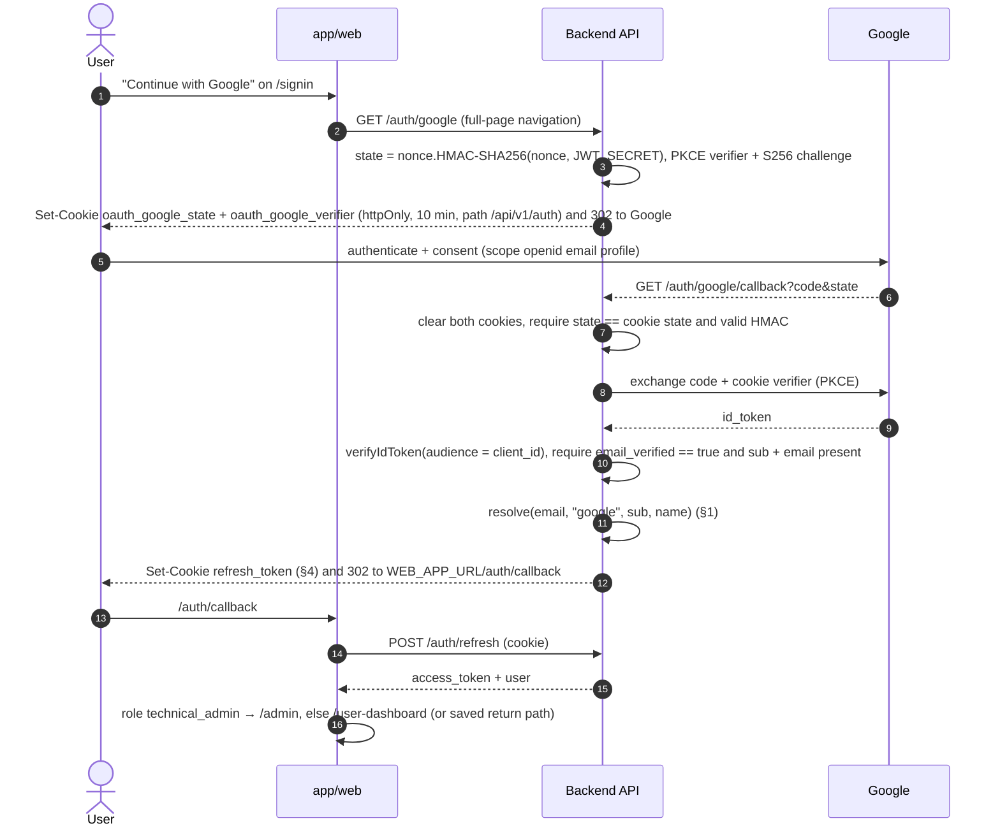
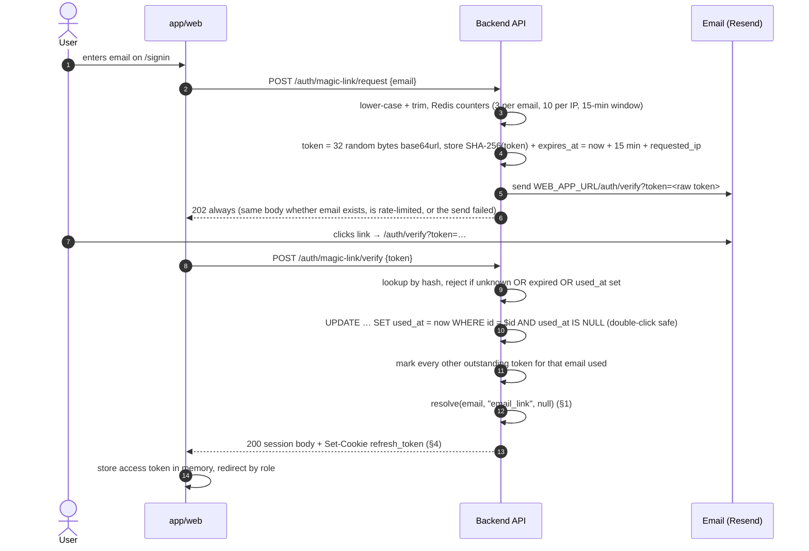

# TravelHub — Auth Flows (Passwordless)

**Status:** Verified against code 2026-10-27 (main @ b176f47)
**Inputs:** [archive/prd.md](archive/prd.md) §5.1, [erd.md](erd.md) (`User`, `AuthIdentity`, `MagicLinkToken` + their unique constraints), [api_contract.md](api_contract.md) §1.
**Code:** `app/Backend/src/auth/**`, `app/Backend/src/users/user.entity.ts`, `app/web/src/lib/{api-client,auth-context,token-store}.ts*`, `app/web/src/app/{signin,auth/callback,auth/verify}/page.tsx`.

Two login methods, no passwords anywhere: **Google OAuth** and **email magic link**. Email is the identity key — both methods resolving the same email land in the same account, by design. This doc describes the sequences as implemented, the account-resolution logic both share, the session/token mechanics, and the races the DB constraints absorb.

All backend routes below live under the `/api/v1` global prefix (`main.ts`).

---

## 1. Shared core: account resolution

Both flows end at `AccountResolutionService.resolve(email, provider, provider_user_id, full_name?)` (`services/account-resolution.service.ts`):

```
resolve(email, provider, provider_user_id?, full_name?):
  in one DB transaction:
    user = SELECT … FROM users WHERE email = lower($email) FOR UPDATE   -- pessimistic_write
    if none:
      INSERT user (email, email_verified_at = now, full_name from profile or null)
      on unique violation (pg 23505): re-SELECT … FOR UPDATE and continue with the winner's row
    if user.is_active = false → 403 FORBIDDEN (no identity upsert, no session)
    INSERT auth_identities (user_id, provider, provider_user_id) ON CONFLICT DO NOTHING
  return user   (the caller issues the session — §4)
```

Constraints that make this safe (entities + `database/migrations/1751600000000-InitAuthTables.ts`):

- `users`: `ux_users_email` unique.
- `auth_identities`: `ux_auth_identities_user_provider` unique (`user_id`, `provider`), and the partial unique index `ux_auth_identities_provider_user` on (`provider`, `provider_user_id`) `WHERE provider_user_id IS NOT NULL` (email-link rows carry `NULL`, so many users can each have one).
- `provider` is the Postgres enum `auth_provider` = `google | email_link`.

**The double-callback race** (same user, two concurrent first-logins — double-clicked Google button, or Google + magic link racing):

- Both requests find no user → both INSERT → `ux_users_email` makes the loser fail → loser re-SELECTs and proceeds against the winner's row. No duplicate accounts.
- Both insert identities → the two unique constraints make the second a no-op (`ON CONFLICT DO NOTHING`). No duplicate credentials.
- The `provider_user_id` uniqueness is also the account-takeover guard: one Google `sub` can never be attached to two users. Because the insert is `DO NOTHING`, a `sub` that already belongs to another account is silently *not* linked rather than rejected — login still succeeds on the email-matched account (Google has verified that email), but the identity row is not created.

`is_active = false` short-circuits inside the transaction: `403 FORBIDDEN`, no session. The Google callback maps this to a redirect with `?error=account_disabled` (§2).

## 2. Google OAuth



Rules, as implemented in `services/google-auth.service.ts` and `auth.controller.ts`:

- The **backend** does the code exchange (authorization-code + PKCE, `google-auth-library` `OAuth2Client`). No Google token ever reaches the browser, and no access token travels in a URL: the callback only sets the refresh cookie and redirects, and the web app obtains its access token with `POST /auth/refresh`.
- `state` is `nonce.signature` — 16 random bytes (hex) signed with HMAC-SHA256 under `JWT_SECRET`. It is checked twice: equality with the `oauth_google_state` cookie (CSRF binding to this browser) and signature validity.
- The PKCE `code_verifier` (32 random bytes, base64url) is kept only in the `oauth_google_verifier` cookie. Both OAuth cookies: `httpOnly`, `sameSite=lax`, `path=/api/v1/auth`, `maxAge` 10 min, `secure` only when `NODE_ENV=production`. They are cleared at the start of the callback whatever happens.
- `sub` — not email — is stored as `provider_user_id`, because Google emails can change while `sub` is stable. `payload.name` becomes `full_name` on first creation only.
- If Google reports `email_verified !== true`, reject — otherwise an attacker with an unverified Google account could claim someone's magic-link account.
- Failures never render the JSON error envelope (it's a browser flow): the callback redirects to `WEB_APP_URL/auth/callback?error=account_disabled` (403 from §1) or `?error=auth_failed` (anything else) and logs a warning.
- `GOOGLE_CLIENT_ID/SECRET/REDIRECT_URI` are optional env vars; when any is empty both endpoints throw `503 SUPPLIER_UNAVAILABLE` ("Google login is currently unconfigured") instead of crashing.

## 3. Email magic link



Rules (`services/magic-link.service.ts`, `services/mail.service.ts`, `entities/magic-link-token.entity.ts`):

- **Raw token is never stored** — only `token_hash` (SHA-256 hex, indexed by `ix_magic_link_tokens_token_hash`). A DB leak yields nothing usable.
- **TTL 15 minutes** (`MAGIC_LINK_TTL_SECONDS = 900`). `magic_link_tokens.user_id` exists but is left `NULL` — the email is the key, the user is resolved at verify time.
- **Single use** enforced by the atomic `used_at IS NULL` update — two tabs clicking the same link produce exactly one session; the second gets the uniform `401 TOKEN_INVALID`.
- Expired / used / unknown tokens return the **same** `401 TOKEN_INVALID` with the same message ("Magic link is invalid or has expired") — no oracle for which emails exist. The verify page shows one screen regardless ("الرابط غير صالح أو منتهي الصلاحية — request a new one").
- **Rate limits (Redis counters, not the global ThrottlerGuard):** `magic_link:email:<email>` max **3** and `magic_link:ip:<ip>` max **10**, each key `INCR` + `EXPIRE 900` on every accepted request (so the window slides forward with activity). Over the cap → still `202`, the token is not created and no email is sent, a debug line is logged. `requested_ip` is stored on the token row for abuse review. The check and the increment are two round-trips, not one atomic script.
- **Request body:** `{ email }` validated with `@IsEmail()`. Response body is always `{ message: "If that email is registered, a link has been sent." }`.
- Requesting a new link does not invalidate prior unexpired ones (15-minute exposure window is the cap), but a **successful verify invalidates all outstanding tokens for that email**.
- **Delivery:** `MailService` POSTs to the Resend REST API when `RESEND_API_KEY` is set (`MAIL_FROM` default `Safariyat <no-reply@auth.safariyat.live>`); when it is empty the full link is written to the backend log instead (dev flow). `send()` never throws — transport failures are logged and the request still returns 202.
- **Purge:** `MagicLinkTokenPurgeService` runs `@Cron(EVERY_DAY_AT_3AM)` (`0 3 * * *`, server time) and deletes rows with `expires_at < now − 24h`, used or not.

## 4. Sessions

Implemented in `services/token.service.ts`, `entities/refresh-token.entity.ts` and the web client.

### Access token

- JWT signed with `JWT_SECRET` (`@nestjs/jwt` default HMAC). Claims: `{ sub: user.id, role: user.role }` plus `iat`/`exp`. Lifetime `ACCESS_TOKEN_TTL_SECONDS`, **default 900 s (15 min)**.
- Returned in the body of `POST /auth/magic-link/verify` and `POST /auth/refresh` as `{ access_token, expires_in, user: { id, email, full_name, phone, role } }` (api_contract §1). Sent back as `Authorization: Bearer <jwt>`; `JwtAuthGuard` verifies it statelessly and attaches the payload to `request.user`.
- **Web storage:** in memory only (`lib/token-store.ts`, a module-level variable — never `localStorage`/`sessionStorage`). It is gone on reload by design; `AuthProvider` re-hydrates on mount with `POST /auth/refresh`, and `api-client.ts` sends every request with `credentials: "include"`. On any `401` the client performs **one** shared in-flight refresh and replays the request once; if the refresh fails the token is cleared and the 401 surfaces.
- `GET /me` (`me.controller.ts`, `JwtAuthGuard`) re-reads the user row, so a role/activation change is visible there immediately even though the JWT claim is frozen until expiry.

### Refresh token

- Opaque **32 random bytes** (base64url). Stored **hashed** (SHA-256 hex) in `refresh_tokens.token_hash` (unique `ux_refresh_tokens_token_hash`, migration `1751700000000-AddRefreshTokens.ts`), with `family_id` (uuid, indexed), `expires_at`, `revoked_at`, `user_agent`, `ip`. One row per issuance; one family per login.
- Lifetime `REFRESH_TOKEN_TTL_DAYS`, **default 30 days**.
- Cookie `refresh_token`: `httpOnly`, `path=/api/v1/auth`, `maxAge` = TTL, `secure` only when `NODE_ENV=production`, `sameSite` = **`none` in production** (web on Vercel and API on the Azure VM are different sites, so the cross-site `fetch` from `api-client.ts` needs it) and `lax` otherwise.

### Rotation and reuse detection (`POST /auth/refresh`)

1. No cookie → `401 UNAUTHENTICATED`. Unknown hash → `401`. `expires_at` in the past → `401` (row left as is).
2. Atomic claim: `UPDATE refresh_tokens SET revoked_at = now WHERE token_hash = $h AND revoked_at IS NULL`.
3. **0 rows affected = the token was already rotated** → theft/reuse signal: every non-revoked token in the `family_id` is revoked, the cookie is cleared, `401` ("Refresh token reuse detected — session revoked"). This also catches a lost concurrent-rotation race, which is why the web client serialises refreshes.
4. `user.is_active = false` → `401` (the old token has already been revoked in step 2, so the chain ends here).
5. Otherwise a new token is issued **in the same family**, a new cookie set, and a new access token returned.

### Logout and revocation

- `POST /auth/logout`: revokes the presented token (`revoked_at = now`, single row — not the family) and clears the cookie. Always `200`, even with no cookie. The access token simply ages out (≤ 15 min exposure — no blocklist).
- Admin deactivation (`PATCH /admin/users/:id { is_active: false }`, `admin.service.ts`) revokes **all** of that user's non-revoked refresh tokens in the same transaction, so the session dies within one access-token lifetime.
- Role changes take effect within one access-token lifetime (the claim is only re-read at refresh). There is no API to change `role` — `technical_admin` is set in the DB.
- Expired and revoked `refresh_tokens` rows are never purged (no cron); they accumulate.

## 5. Roles and guards

- `users.role` is the Postgres enum `user_role` with exactly two values: **`user`** (default) and **`technical_admin`** (`users/user.entity.ts`). No other role exists.
- **`JwtAuthGuard`** (`guards/jwt-auth.guard.ts`): hand-rolled, no Passport. Missing/malformed `Authorization: Bearer` or an invalid/expired JWT → `401 UNAUTHENTICATED`. It is **not** registered globally — an endpoint is public unless it opts in with `@UseGuards(JwtAuthGuard)` (flights search, airports, `/auth/*`, `/health` and the webhook receivers are public by design).
- **`RolesGuard`** (`guards/roles.guard.ts`): reads `@Roles(...)` metadata (handler first, then class via `getAllAndOverride`). **No metadata, or an empty list → allow** — the guard is opt-in per endpoint. Otherwise `request.user.role` must be in the list → else `403 FORBIDDEN`. It must run after `JwtAuthGuard` (it reads `request.user`).
- Admin surfaces use the pair at class level: `AdminController` (`/admin/*`), `LedgerController` (`/admin/ledger`), `AdminSupportController` (`/admin/support/tickets`) — all `@UseGuards(JwtAuthGuard, RolesGuard) @Roles(UserRole.TechnicalAdmin)`.
- Web: `app/admin/layout.tsx` hides the admin tree unless `user.role === "technical_admin"`; this is UX only — authorization is the backend guard.

## 6. Phase 2 note (agents)

Travel Agent accounts would be created by a Travel Company Admin (no self-registration) but authenticate with these exact same two flows — the invitation email is effectively a magic link. Nothing here needs restructuring for Phase 2; the `user_role` enum gains values and an invitation-issuance flow gets added.
