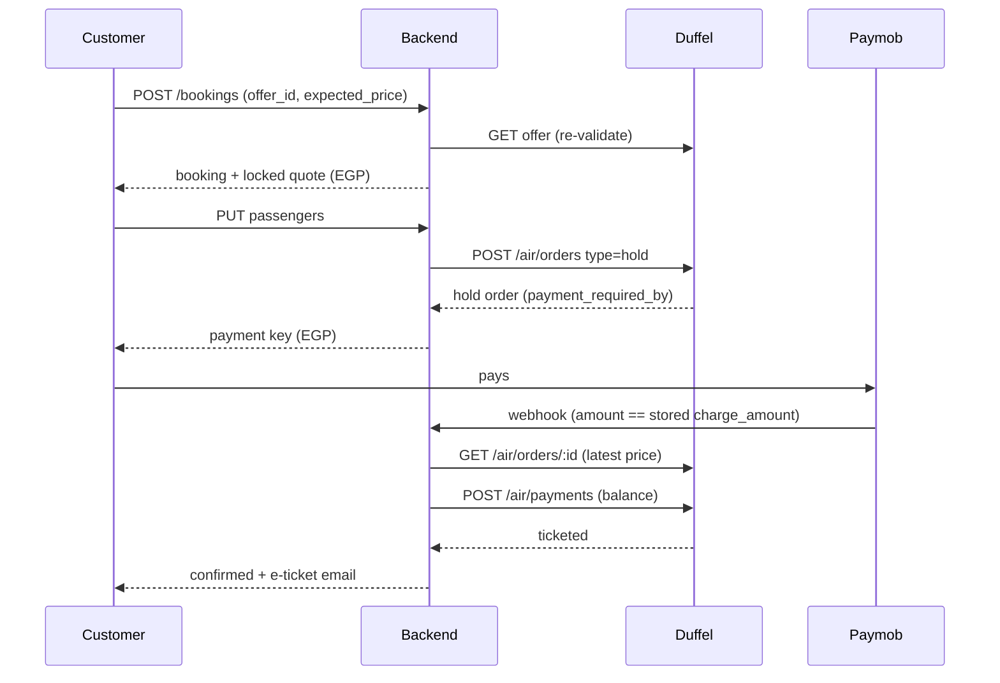

# TravelHub — Booking Flow v2 Plan (pricing, hold & retry, checkout, search, ledger)

**Status:** Draft v1
**Date:** 2026-10-09
**Inputs:** a code audit of the live booking path (search → offer → passengers → Paymob → Duffel order → reconciliation → refunds → ledger → admin), [booking_state_machine.md](booking_state_machine.md), [api_contract.md](api_contract.md), [duffel_api_integration_guide.md](duffel_api_integration_guide.md), and Duffel's own docs (offer requests, offers schema, holding orders, Duffel Links).

This plan changes behaviour that [api_contract.md](api_contract.md) and [booking_state_machine.md](booking_state_machine.md) currently pin down. **Each branch updates those docs first, in the same PR**, so the contract stays the source of truth.

---

## 0. Decisions (locked 2026-10-09)

| # | Decision |
|---|---|
| D1 | **Hold-then-pay** wherever the airline allows it. **Instant order + automatic re-shop/retry** where it doesn't. |
| D2 | **EGP is the default currency everywhere** (search, checkout, payment, emails, PDF). |
| D3 | **Users can switch the display currency.** EGP stays the default. |
| D4 | **Automatic FX rate** (daily feed) with a safety buffer, an admin override, and the rate snapshotted on every booking. |
| D5 | Margin is managed by the admin through **rules** (percentage and/or fixed, min/max, optional scope). |
| D6 | Search must expose **fare options (brands) and cabin classes**, not just one card per offer. |
| D7 | The passenger form is **generated from Duffel's offer requirements** and rendered in our own UI. Duffel Links is rejected as the main flow (§7). |
| D8 | Auto-retry may absorb a price increase of **min(50% of margin, $10)**. |
| D9 | Existing test bookings and ledger data are **archived** (hidden from admin, not deleted). |
| D10 | The live Paymob account charges **EGP only**. The currency switcher is **display-only**. |
| D11 | FX buffer **2%**. |
| D12 | Retry window **90 minutes**. |
| D13 | **Top priority (user):** the moment the customer pays, they must clearly see *"your payment was successful and we are processing your order"*. They must keep seeing honest progress until the ticket is issued or the refund is sent (§3 B1b). |

All open questions from §9 are resolved.

---

## 1. Audit findings (why this plan exists)

### 1.1 Money-safety bugs (fix first, branch B1)

| # | Bug | Where | Impact |
|---|---|---|---|
| F1 | Auto-refunds created on `order_failed` are saved as `pending` but **never enqueued** to `refund_execution_queue`. They also carry a fake `provider_refund_id`. | `order-fulfillment.service.ts` `handleDefinitiveFailure`; `duffel-reconciliation.service.ts` `handleVerifiedAbsent` | Customer charged, told "refunded", refund never happens. |
| F2 | `DuffelService.listOrders` returns `[]` on any error. Reconciliation treats `[]` as "verified absent" and fails + refunds the booking. It also reads only one page (max 200). | `duffel.service.ts` `listOrders`; `duffel-reconciliation.service.ts` `reconcileBooking` | A Duffel outage during the sweep can refund a booking that **was ticketed**. |
| F3 | `supplier_charge` ledger row is written only when the synchronous `createOrder` succeeds. It is missing for bookings confirmed by the `order.created` webhook or the reconciliation sweep. | `confirmBookingFromOrder` | Ledger can't compute profit. Wallet estimate is wrong. |
| F4 | Infant linking is reversed. We put `infant_passenger_id` on the infant, pointing at the adult. Duffel puts it on the **adult**, pointing at the infant. | `order-fulfillment.service.ts` `mapPassengersToDuffel` | Every booking with an infant very likely fails after payment. |
| F5 | Missing document fields are sent as `''` (`expires_on`, `issuing_country_code`) instead of being omitted or blocked. | same | 422 after payment. |
| F6 | Spec says Duffel `503` → retry with backoff. Code treats 503 as ambiguous and never retries. | `duffel.service.ts` `createOrder` | Avoidable `order_failed`. |
| F7 | The passenger ↔ Duffel passenger-id mapping is by array index only. Duffel notes a passenger's `type` can differ per offer. | `bookings.service.ts` `savePassengers` | Wrong passenger bound to wrong Duffel id if order or type differs. |
| F8 | The `order.created` webhook's fallback lookup reads `metadata.idempotency_key`, but createOrder writes `supplier_idempotency_key`, so it never matched. Its spec encoded the same wrong key. | `duffel-webhook.processor.ts` | The fast path for timed-out orders never fired. Every timeout waited 15 min for reconciliation. |
| F9 | The confirmation email was sent only from the synchronous createOrder path. Bookings confirmed by webhook or reconciliation never got an email. The webhook and reconciliation paths also duplicated documents (and would have duplicated the supplier charge) when racing the sync path. | `order-fulfillment.service.ts`, `duffel-reconciliation.service.ts` | Silent confirmations and double rows. |
| F10 | Duffel offers label lap infants `infant_without_seat`. We passed that label straight to the checkout form, whose DTO only accepts `infant`. | `bookings.service.ts` `createBooking` | Any search with an infant failed at the passenger step with "Validation failed". |
| F11 | Search sends `{type: 'child'}` / `{type: 'infant'}`. Duffel's guide says passengers **under 18 must be searched by `age`**. | `flights.service.ts` | Child/infant searches may be rejected or mis-priced. Needs ages collected in the search UI → **B5**. |

**B1 status (2026-10-09):** F1–F10 fixed on `fix/booking-money-safety`. F11 moved to B5.

### 1.2 Customer-facing problems

| Problem | Root cause |
|---|---|
| "Booking fails, no error returned" | Validation errors reach the UI as the generic `"Validation failed"`. `details.constraints` is never shown per field. Most Duffel rules (name charset, DOB vs type, passport expiry) are only checked by Duffel **after payment**. The Duffel error digest is stored in status history and never shown to the user or admin. |
| Phone number | Free-text field. The backend demands strict E.164 (`+20…`) and the placeholder is Saudi. There is no country picker. |
| Pricing conflict | Up to **4 different numbers** for one flight: search (Duffel USD, no margin), checkout review (same, labelled "total incl. taxes"), payment page (USD + margin), Paymob (EGP at a **hardcoded** 50 rate in `paymob.service.ts`). The rate is recomputed (not stored) at webhook verification and refund time. |
| Can't manage margin properly | One global `markup_rules` row. "Fixed" is in minor units **of whatever currency the offer is in**. Margin is applied only after the user picks a flight. |
| Missing flight options / classes | `max_connections` is not sent and Duffel defaults to **1** (confirmed in Duffel docs), so 2-stop routes are hidden. Fare brands come back as separate near-identical cards with no brand, baggage or conditions shown. Cabin, children and infants can't be changed on the results page. |
| Provider not responding at booking | The price is locked at booking creation. The card step can take 10+ min. If the price or offer changes, Duffel rejects and we refund instead of re-checking availability at the same price. |
| Admin ledger incomprehensible | Payments recorded in USD while EGP was charged. No FX rate stored. Supplier charge often missing (F3). No margin line. "Duffel wallet" has no top-ups. Rows show raw booking UUIDs. No failure reason or status timeline in admin. |

---

## 2. Target flow (end to end)

```
SEARCH ─► results priced in display currency (EGP default), margin + FX included,
          grouped by itinerary with fare options & cabins
   │
   ▼
SELECT FARE ─► POST /bookings {offer_id, expected_price}
   │            re-validate offer at Duffel, re-price
   │            price differs? ─► 409 PRICE_CHANGED (old/new) ─► user accepts or goes back
   ▼
PASSENGERS ─► form generated from Duffel requirements (GET /bookings/:id/form)
   │            client + server validation, per-field Arabic errors
   ▼
LOCK ─► offer holdable? ── yes ─► create Duffel HOLD order (no money taken yet)
   │                    └─ no ──► re-validate offer price once more
   │   failure here = clear error, customer NOT charged
   ▼
PAY (Paymob, EGP) ─► webhook verifies amount against the STORED charge_amount
   ▼
FULFIL ─► hold:    GET order → price same? pay hold (POST /air/payments) → confirmed
   │      instant: POST /air/orders → confirmed
   │      price changed / offer gone / verified absent?
   ▼
RE-SHOP & RETRY (delayed jobs) ─► same flights, price within tolerance → book → confirmed
                                 window exhausted → order_failed → refund ENQUEUED → notify
```



---

## 3. Branches (in order)

| Branch | Size | Depends on | Can run in parallel with |
|---|---|---|---|
| B1 `fix/booking-money-safety` | S | — | — |
| B1b `feat/post-payment-experience` | S–M | B1 | B2, B3 |
| B2 `feat/pricing-engine` (margin, FX, currency) | L | B1 | B3 |
| B3 `feat/checkout-form` (Duffel-driven form, phone, errors) | M | B1 | B2 |
| B4 `feat/hold-and-retry` | L | B2 | — |
| B5 `feat/search-fares` (options & classes) | M | B2 | B6 |
| B6 `feat/admin-finance` (ledger v2 + admin bookings) | M | B2, B4 | B5 |

All branches start from `main` **after** `chore/production-hardening` and `test/web-suite` are merged. Each PR updates `api_contract.md` / `booking_state_machine.md` / `erd.md` as needed and keeps backend + web test suites green.

---

### B1 — `fix/booking-money-safety`

**Scope:** F1–F7 only. No UX changes.

- Route every system refund (order_failed, reconciliation) through `RefundExecutionService.createPendingRefund` and **enqueue** it. Drop the fake `provider_refund_id`.
- Add a sweep that re-enqueues `pending` refunds older than N minutes, as a safety net matching the existing `processed_at IS NULL` sweep pattern.
- `listOrders`: throw on failure instead of returning `[]`. Paginate with `after` until exhausted, or filter tighter by `created_after`. Reconciliation: an error means "unknown, try next run", **never** "absent".
- Write the `supplier_charge` ledger row inside `confirmBookingFromOrder`, idempotently (one per booking), so all three confirmation paths record it.
- Fix the infant mapping: set `infant_passenger_id` on the **adult**. Verify against Duffel's create-order docs and add a unit test.
- Omit `identity_documents` unless every field is present.
- Map passengers to Duffel ids by **type + order within type**, not raw index. Reject on mismatch.
- `503` on create order: retry with backoff (3 tries, 2s/5s/10s) per the state-machine spec.

**Acceptance:**
- An `order_failed` booking produces a refund that reaches `succeeded` in Paymob sandbox with no admin action.
- A mocked `listOrders` failure leaves the booking in `paid`.
- Every `confirmed` booking has exactly one `supplier_charge` row (spec test per confirmation path).
- A booking with 1 adult + 1 infant creates a Duffel test order successfully.

---

### B1b — `feat/post-payment-experience` (D13: "payment successful, we're processing your order")

**Why this is its own early branch:** the user ranked this as the most important customer-facing fix. It also covers a real hazard found in the audit.

**Audit finding (hazard):** `checkout/payment-return` throws away Paymob's result params and sends the customer back to `/checkout/payment`. If the Paymob webhook hasn't landed yet, the booking is still `awaiting_payment`. The page then calls `payment-intent` again, which **registers a new Paymob order and shows a fresh card form**. A customer who just paid sees the payment form again, thinks the payment failed, and may **pay twice**. The current "paid" screen also says *"don't close this page"*, even though fulfillment runs on the server and can take up to 90 minutes with retries (D12).

**Backend:**
- **Fast payment confirmation on return.** `payment-return` posts Paymob's callback query string to a new `POST /payments/paymob/return`. The backend verifies Paymob's HMAC on it (same scheme as the processed webhook — confirm the exact field list in Paymob docs). If valid and successful, it runs the **same idempotent processing** as the webhook: amount check → `paid` → enqueue fulfillment. Whichever arrives first wins, and the other is a no-op.
- Fallback if the HMAC can't be verified: query Paymob's transaction inquiry by transaction id.
- `payment-intent` refuses to create a new Paymob order while the latest attempt is younger than ~2 min **and** the return said `success=true`. It returns `409 PAYMENT_PROCESSING` instead. This is the double-charge guard.
- `GET /bookings/:id` gains a `progress` object:
  - `stage`: `payment_processing | payment_confirmed | issuing_ticket | retrying | confirmed | refunding | refunded`
  - `paid_amount` / `paid_currency` (EGP)
  - `payment_reference`, `paid_at`
  - `next_attempt_at`, `deadline_at` (paid_at + 90 min)
  - `message_key`

  The frontend renders from `message_key` only, never from raw statuses.
- **Emails**, all in Arabic, idempotent per booking + stage:
  1. **Payment received** — sent the moment payment is confirmed. Amount, reference, "we're issuing your ticket", link to the booking page.
  2. **Still working** — sent once if not confirmed after ~10 min. "The airline is responding slowly. Your money is safe. We'll keep trying for up to 90 minutes and refund in full if we can't issue it."
  3. **Confirmed** — exists today, with PDF.
  4. **Refund issued** — amount in EGP, refund reference, "the time it takes to appear depends on your bank".

**Frontend:** one shared `BookingProgress` component, used on the payment page (after return), confirmation page, `/bookings/[id]` and the dashboard card.
- Step timeline: ✓ **تم الدفع بنجاح** (amount + reference) → ⏳ **جاري إصدار التذكرة مع شركة الطيران** → ✓ **تم تأكيد الحجز** (PNR + ticket download).
- Failure branch: **جاري استرداد المبلغ** → ✓ **تم رد المبلغ**.
- Copy: *"You can safely close this page — we'll email you as soon as your ticket is issued"*. This replaces "don't close this page".
- The payment-return page shows ✓ "payment received" immediately when Paymob says `success=true`, while the backend verifies. It **never** shows the card form again in that state.
- During `retrying`: a calm message and the deadline time, never an error colour.
- The user dashboard lists in-progress bookings at the top with their stage.

**Acceptance:**
- With the webhook artificially delayed by 60 s, a customer returning from Paymob sees "payment successful" within ~2 s and is never shown the card form again.
- Exactly one Paymob order per successful payment.
- The "payment received" email arrives before the ticket email.
- Closing the tab and reopening `/bookings/:id` shows the correct stage.
- All four stage emails are covered by tests.

---

### B2 — `feat/pricing-engine` (margin, FX, display currency)

#### Price model (one function, used everywhere)

```
supplier_amount      = offer.total_amount            (Duffel billing currency, today USD)
margin_amount        = MarginService(rule, offer)    (in supplier currency)
fx_mid               = USD→EGP mid rate from feed
fx_applied           = fx_mid × (1 + fx_buffer_pct)  (buffer covers rate drift + card fees)
charge_amount (EGP)  = ceil_to_whole_pound((supplier_amount + margin_amount) × fx_applied)
display_amount       = charge_amount converted EGP→display currency at mid rate (display only)
```

`PricingService.quote(offer, displayCurrency)` returns `{ charge: {amount, 'EGP'}, display: {amount, currency}, breakdown }`. It is called by search, offer detail, booking creation and re-shop. The frontend **never** does price math. It only formats.

#### Margin rules (replace `markup_rules`)

`margin_rules`: `id, name, priority, is_active, origin?, destination?, airline_iata?, cabin_class?, percent (decimal), fixed_amount (int minor), fixed_currency, min_amount?, max_amount?, valid_from?, valid_to?, created_by, timestamps`.

- Evaluation: active rules matching the offer, highest `priority` wins. A mandatory default rule (no scope) is the fallback.
- `margin = clamp(supplier × percent + fixed(converted), min, max)`.
- Migrate the existing active markup rule into a default margin rule. `bookings.markup_rule_id` becomes `margin_rule_id`, and the old table is kept read-only for history.
- Admin UI takes **normal amounts** with a currency selector, never minor units. It has a live preview: "a $300 flight → margin $X → customer pays Y EGP".

#### FX rates

- New `fx_rates` table: `base, quote, rate_mid, source, fetched_at, is_override, override_expires_at, set_by_user_id`.
- Cron fetches daily, plus an hourly cache refresh. Candidate source: ExchangeRate-API open endpoint (no key, daily updates, commercial use allowed, **requires a visible "Rates By Exchange Rate API" attribution link**, rate-limited). Put the link in the footer, or move to a keyed plan or another source. Confirm EGP is covered before building.
- Failure policy: use the last good rate if < 48h old. Older than that → block new checkouts and alert admin (Sentry + admin dashboard banner).
- Admin can set an **override rate** with an expiry, which is audited.
- `fx_buffer_pct` is an admin setting, default **2%** (D11).

#### Snapshot on the booking (new columns)

`supplier_amount, supplier_currency, margin_amount, fx_rate_mid, fx_buffer_pct, fx_rate_applied, fx_source, fx_fetched_at, charge_amount, charge_currency ('EGP'), display_currency`.

- Paymob payment key, webhook amount check and refunds use **`charge_amount` as stored**.
- `toPaymobGatewayAmount` and the hardcoded rate table are deleted.

#### Display-currency switcher

- Header dropdown: **EGP (default)**, USD, SAR, AED, EUR, KWD (extendable list in config). Choice is stored in a cookie, and on the user profile when signed in.
- `GET /flights/search?currency=SAR` returns `display` prices in SAR plus the `charge` price in EGP.
- Whenever display ≠ charge currency, checkout and payment show: *"You will be charged X EGP"*.
- The live Paymob account charges **EGP only** (D10), so the switcher is display-only. The charge is always EGP.

#### Price-change guard

- `POST /bookings` takes `expected_charge_amount`. If the re-validated quote differs → `409 PRICE_CHANGED { old, new }`.
- The UI shows an "accept new price / back to results" modal. No silent re-pricing ever again.

**Acceptance:**
- The same EGP number appears on search card, checkout, payment page, Paymob, confirmation email and PDF.
- Changing the FX feed after payment does not change the refund amount.
- The admin can create a route-scoped rule and see it applied in search within one cache TTL.

---

### B3 — `feat/checkout-form` (Duffel-driven form, phone, errors)

#### Form schema from Duffel

New `GET /bookings/:id/form` built from the stored offer. Duffel offer fields used:
- `passengers[].type/age`
- `passenger_identity_documents_required`
- `supported_passenger_identity_document_types`
- `supported_loyalty_programmes`
- the departure/return dates (for age and passport-expiry checks)

Response per passenger: type, age band at **last travel date**, required fields, allowed document types, loyalty programmes. The web renders the form from this schema, so the form adapts to whatever Duffel requires for that offer.

#### Field rules (enforced in the browser **and** the DTO)

| Field | Rule |
|---|---|
| Given/family name | Latin letters, space, `-`, `'` only, length per Duffel's schema. Arabic input shows "write it as in the passport, in English letters". |
| Title / gender | Consistent pairs (mr↔m, mrs/ms/miss↔f). Fix the duplicate "الآنسة/آنسة" labels. |
| Date of birth | Age at last flight date must fit the passenger type. Infant < 2, child per offer. |
| Phone | **Country picker (flag + dial code), default Egypt +20**, national-number field, validated with `libphonenumber-js`, stored as E.164. |
| Email / phone | Entered **once** for the lead passenger and copied to all passengers by default, editable per passenger. |
| Nationality / issuing country | Searchable country dropdown (Arabic names → ISO-2), never free text. |
| Passport expiry | After the last flight date. Warn if < 6 months, since many destinations require it. |

#### Errors

- The backend returns field-level errors with paths (`passengers[1].phone_number`) in `details.fields`. The web shows each one **under its field**, in Arabic, via a message map.
- The Duffel error digest (`invalid_phone_number (passengers/0/phone_number)`, `offer_no_longer_available`, `price_changed`, …) gets an Arabic customer message map. The raw digest is shown to admins (B6).
- No path may end in a bare "Validation failed" or "حدث خطأ غير متوقع". Add a Playwright spec for each error class.

**Acceptance:**
- The bad passenger data from the audit (wrong phone, Arabic name, infant without adult, expired passport) is all rejected **before payment** with per-field messages.
- A valid form produces a Duffel order on the first attempt in test mode.

---

### B4 — `feat/hold-and-retry`

#### Hold path (offer `payment_requirements.requires_instant_payment = false`)

1. After passengers are saved, create a Duffel order with `type: "hold"` (no `payments`). Store `supplier_order_id`, `payment_required_by`, `price_guarantee_expires_at`.
2. The payment window shown to the customer = earliest of (`payment_required_by`, `price_guarantee_expires_at` if set, our cap e.g. 20 min).
3. Hold creation fails (4xx) → show a clear message, no charge, suggest other fares. Ambiguous (5xx/timeout) → retry once, then error. Orphan holds lapse on their own at `payment_required_by` and cost nothing. A sweep still matches them by `metadata.supplier_idempotency_key` for visibility.
4. After Paymob success, `GET /air/orders/:id` for the latest price, as Duffel's guide requires (a stale price → `price_changed`):
   - Same price → `POST /air/payments` (`type: balance`, order's `total_amount`/`total_currency`) → `confirmed`.
   - Higher, within tolerance → pay anyway and record the absorbed difference in the ledger (`fx_or_price_loss`).
   - Higher, beyond tolerance → re-shop (below).
   - `schedule_changed` error → re-shop, and notify the customer if the times differ.

#### Instant path (airline requires instant payment)

- Re-validate the offer immediately before issuing the Paymob payment key (closes the 10-minute gap). A price change here → `PRICE_CHANGED` modal, no charge yet.
- After payment, `POST /air/orders` as today.

#### Re-shop & retry engine (both paths)

Triggers:
- Definitive 4xx that means price or availability (`price_changed`, `offer_no_longer_available`, expired)
- Reconciliation "verified absent"
- Hold price beyond tolerance
- Admin "retry now"

Per attempt:
1. New offer request with the same route, dates, cabin, passengers and `max_connections`.
2. Pick an offer with **identical flight numbers + departure times on every slice**, same fare brand if available, else the same cabin.
3. Re-map our passengers to the new offer's passenger ids (type + order).
4. If `new_price ≤ paid_supplier_amount + tolerance` → create order (hold+pay or instant) → `confirmed`. Record the price difference in the ledger.
5. Else schedule the next attempt.

Rules:
- **Schedule:** BullMQ delayed jobs at +2, +5, +10, +20, +40 min. Stop at a max window of **90 min** (D12) or 24h before departure, whichever is first. Every attempt is written to the new `fulfillment_attempts` table: `booking_id, attempt_no, trigger, offer_id, supplier_price, outcome, duffel_request_id, error_digest, created_at`.
- **Tolerance:** `min(absorb_pct × margin_amount, absorb_cap)`. Admin settings, default **50% of margin, capped at $10** (D8).
- **Ambiguous outcomes (500/timeout)** keep today's rule: never re-POST until reconciliation has **verified absence**. Then re-shop instead of refunding immediately.
- **Window exhausted** → `order_failed` → refund **enqueued** (B1) → email: "we couldn't secure this fare at the paid price, full refund issued".
- **Customer UX** while retrying: "finalizing your booking with the airline" plus an email if it exceeds ~5 min.
- **Admin actions:** Retry now · Book at new price (absorb X, audited) · Refund now.

#### State machine changes

- No new top-level statuses. `paid` covers "paid, fulfilling or retrying". Retry detail lives in `fulfillment_attempts`.
- The hold is stored on `awaiting_payment` bookings (`supplier_order_id` set, `hold_expires_at`).
- Update `booking_state_machine.md` §4. Replace "never re-POST an order" with: "never re-POST **on an ambiguous outcome**. A re-shop is allowed only after a definitive failure or verified absence, and it always uses a **new** offer."
- The expiry sweep must also cover held orders (`hold_expires_at`).

**Acceptance:**
- Duffel Airways (holdable) books via hold+pay.
- A simulated `price_changed` within tolerance auto-books on retry.
- Beyond tolerance, it refunds after the window.
- Every attempt is visible in admin.

---

### B5 — `feat/search-fares` (options & classes)

- Send `max_connections: 2` (configurable). Duffel defaults to 1.
- Collect **children's and infants' ages** in the search form and send `{age}` instead of `{type}` for under-18s, as Duffel's guide requires (F11). The ages also pre-fill and constrain date of birth in B3's form.
- Extend `NormalizedOffer`:
  - `fare_brand_name` per slice
  - `cabin_class` + `cabin_class_marketing_name` per segment/passenger
  - baggage per passenger (`checked`/`carry_on` quantities)
  - `base_amount`/`tax_amount`
  - conditions per slice
  - `payment_requirements` (holdable)
  - the priced `charge`/`display` amounts (B2)
- **Group** offers by itinerary key (all slices' flight numbers + departure times):
  - One card per itinerary: "from 12,450 EGP", with stops, layover airports and durations.
  - An expandable **fare options** row per brand: name, cabin, bags, refundable/changeable badges, price, select button.
- Results page lets the user change **cabin class**, adults, children and infants without going back home.
- Filters: stops (0/1/2), airline, departure-time bands, price, refundable only. Sort: cheapest / fastest / best.
- If result counts get large, move to `return_offers=false` + paginated list-offers (`limit`, `after`, server-side sort) to keep payloads small.
- Note: Duffel **test mode** mostly returns Duffel Airways. Verify variety with a live key before judging.

**Acceptance:**
- A route that previously showed N near-duplicate cards shows one card with N fare options.
- A business-class search from the results page works.
- 2-stop itineraries appear when they exist.

---

### B6 — `feat/admin-finance` (ledger v2 + admin bookings)

#### Ledger v2

Stay single-entry (double-entry is overkill at this scale). Every row gets:
- `amount` + `currency` (the real currency of that money movement)
- `fx_rate_to_egp`
- `amount_egp` (reporting currency)
- `account`: `customer_cash` · `duffel_balance` · `margin_revenue` · `fx_and_price_diff` · `refunds`

Entry types written per booking lifecycle:

| Event | Rows |
|---|---|
| Paymob success | `customer_payment` +charge_amount EGP (`customer_cash`) |
| Duffel ticketed | `supplier_charge` −supplier_amount USD (`duffel_balance`), `margin_recognized` +margin (`margin_revenue`) |
| Absorbed price diff on retry | `price_diff` −diff (`fx_and_price_diff`) |
| Refund to customer | `gateway_refund` −amount EGP |
| Duffel cancellation refund | `supplier_refund` +amount USD |
| Admin top-up of Duffel balance | `supplier_topup` +amount USD (new, so the wallet estimate means something) |

Check whether Duffel exposes the balance via API. If not, top-ups are entered by the admin.

#### Admin screens

- **Booking finance view** (one page per booking): charged (EGP + USD equivalent), supplier cost, margin, FX/price diff, refunds, **net profit**. Also the status timeline (from `booking_status_history`), Duffel order id, PNR, failure reason (translated + raw digest + request id), `fulfillment_attempts`, and the actions from B4.
- **Bookings list:**
  - Columns: PNR, route + date, customer, status (with reason tooltip), charged EGP, margin EGP, attempts.
  - Filters: status, date range, "needs attention" (paid > 10 min, retrying, refund pending/failed).
- **Ledger page:** grouped by booking by default (expand for rows). Human labels instead of enum names. Explained sign convention. Totals in EGP. Export CSV.
- **Dashboard tiles:** today's FX rate (+ override badge), margin this month, bookings needing attention, Duffel balance estimate.

#### Data cleanup

- Add `environment` (`test`/`live`) on bookings and ledger rows, derived from the Duffel key mode at creation. Hide `test` in admin by default.
- One-time script:
  - Backfill missing `supplier_charge` rows.
  - Recompute `amount_egp` for historical rows using the stored or sandbox rate, flagged `estimated`.
  - Archive existing test-mode data (D9): mark `environment = test`, hide by default, never hard-delete.

**Acceptance:**
- For any confirmed booking, admin can explain in one screen how much was charged, paid to Duffel, and earned.
- Ledger totals per account reconcile with sums over bookings.

---

## 4. Data model changes (summary)

| Table | Change | Branch |
|---|---|---|
| `refunds` | `provider_refund_id` nullable until gateway returns (already nullable since 1756…). Stop writing fake ids. | B1 |
| `margin_rules` | **new** (replaces `markup_rules`) | B2 |
| `fx_rates` | **new** | B2 |
| `app_settings` | **new** key/value (fx_buffer_pct, absorb_pct, absorb_cap, retry window) | B2/B4 |
| `bookings` | pricing snapshot columns (B2) · `hold_expires_at`, `price_guarantee_expires_at` (B4) · `environment` (B6) | B2/B4/B6 |
| `users` | `preferred_currency` | B2 |
| `fulfillment_attempts` | **new** | B4 |
| `ledger_entries` | `account`, `fx_rate_to_egp`, `amount_egp`, `environment`, `is_estimated` + new entry types | B6 |

## 5. API changes (summary; formalize in api_contract.md per branch)

- `GET /flights/search?…&currency=` → offers grouped with `fare_options[]`, each with `charge` + `display` money. (B2/B5)
- `POST /bookings {offer_id, expected_charge_amount}` → `409 PRICE_CHANGED`. (B2)
- `GET /bookings/:id/form` → passenger form schema. (B3)
- Validation errors → `details.fields[{path, code, message}]`. (B3)
- `GET /bookings/:id` → adds `fulfillment` state (`locking | awaiting_payment | fulfilling | retrying | confirmed | failed`) for the UI. (B4)
- Admin: `/admin/margin-rules`, `/admin/fx-rates` (+ override), `/admin/settings`, `/admin/bookings/:id/finance`, `/admin/bookings/:id/retry`, `/admin/bookings/:id/rebook`, `/admin/ledger?group_by=booking`, `/admin/ledger/export.csv`. (B2/B4/B6)

## 6. Testing strategy

- Backend: unit tests per service (`PricingService`, `MarginService`, FX fallback, retry scheduler, passenger mapping incl. infants). e2e for hold → pay → confirm and retry → refund with a mocked Duffel.
- Web: Vitest for the form schema renderer, phone input and money display. Playwright for price-changed modal, per-field errors, currency switch, and fare-options card.
- Manual: Duffel test mode with **Duffel Airways** (holdable) plus one instant-only airline, and Paymob sandbox test cards.

## 7. "Can we use Duffel's own form?" — options considered

| Option | What it is | Why not / when |
|---|---|---|
| **Duffel Links** | Hosted search-and-book page. Session created via `POST /links/sessions` with branding, `traveller_currency` and markup. User returns to our success URL with `order_id`. | Takes payment through **Duffel's** checkout, not Paymob. That means no local EGP methods and no control over the charge. Our booking, ledger, refund and PDF flows would only see an `order_id` afterwards, and we don't control Arabic/RTL UX. **Rejected as main flow.** It could be a fallback "book via partner" link later. |
| **Duffel Components** (`@duffel/components`) | Drop-in UI pieces: ancillaries (extra baggage, seats, etc.) and card forms for Duffel Payments. | No passenger-details form was found in the published components. **Adopt later** for seats and bags (post-B5). |
| **Schema-driven own form (chosen)** | Our UI, generated from the offer's own requirements (B3). | Gets the benefit of "Duffel decides what's required" while keeping Paymob, Arabic UX and our data model. |

## 8. Docs to update

`api_contract.md` (B2–B6), `booking_state_machine.md` §4 + hold notes (B4), `erd.md` (B2/B4/B6), `prd.md` pricing/refund sections (B2/B4), `deployment.md` FX feed env + cron (B2), `README.md` feature list.

## 9. Open questions

All resolved on 2026-10-09 — see D8–D13 in §0. Remaining items to *verify* (not decide) during implementation:

- Paymob's transaction-response-callback HMAC field list (B1b).
- That the FX feed covers EGP, and the attribution link placement (B2).
- Whether Duffel exposes the account balance via API (B6).
- The exact Duffel error codes for price change / offer unavailable (B4).

---

**Sources consulted (Duffel):** [Create offer request](https://duffel.com/docs/api/v2/offer-requests/create-offer-request) (`max_connections` default 1, `supplier_timeout`), [Offer schema](https://duffel.com/docs/api/v2/offers/schema) (fare brand, baggage, payment requirements, document types), [Holding orders and paying later](https://duffel.com/docs/guides/holding-orders-and-paying-later), [Duffel Links](https://duffel.com/docs/guides/duffel-links), [Components changelog](https://changelog.duffel.com/announcements/we-have-released-new-components-for-handling-baggage-selection). FX feed terms: [ExchangeRate-API free endpoint](https://www.exchangerate-api.com/docs/free).
