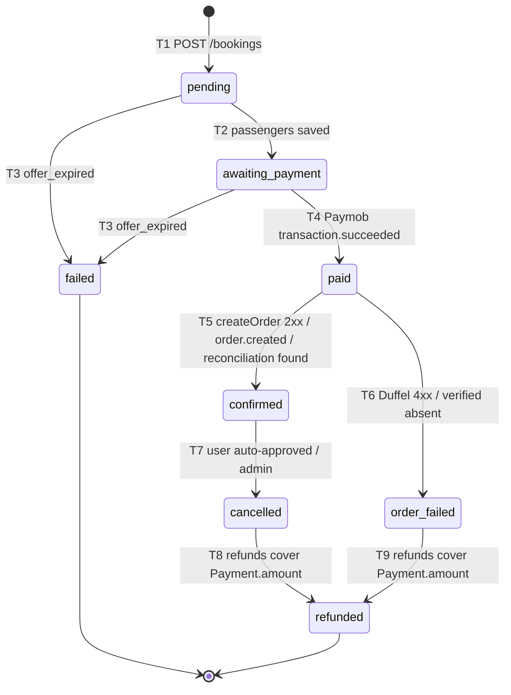

# TravelHub — Booking / Payment / Refund State Machine

**Status:** Verified against code 2026-10-27 (main @ b176f47)
**Pending:** reflects fix branches fix/trust-proxy-and-idempotency-scope, fix/refund-transaction-id, fix/payment-after-terminal-state, fix/refund-executing-marker not yet merged to main.
**Inputs:** [erd.md](erd.md) (status enums, invariants), [archive/prd.md](archive/prd.md) §5.3–5.5 (refund policy, "paid but not booked" requirement), [duffel_api_integration_guide.md](duffel_api_integration_guide.md) §4 (no supplier idempotency, ambiguous-outcome handling).
**Source of truth:** `app/Backend/src/bookings/services/booking-state-machine.service.ts` (`LEGAL_TRANSITIONS`). Every other file named below is relative to `app/Backend/src/`.

This doc describes the **only legal transitions** for `Booking.status`, `Payment.status`, and `Refund.status` as the backend implements them today, who/what triggers each, the guards that hold, and the side effects that fire. The payment gateway is **Paymob** (the `PaymentProvider.Stripe` enum value still exists but nothing creates a Stripe payment; the `payments.provider` column default is `paymob` (pending: fix/refund-transaction-id)).

**Global rules (enforced by `BookingStateMachineService.transitionTo`):**

1. Every `Booking.status` change writes a `BookingStatusHistory` row (`from_status`, `to_status`, `changed_by_user_id` — null for system/webhook/sweep — and `reason`) **in the same DB transaction** as the status update. Booking creation writes an initial `pending → pending` history row (`recordInitialHistory`, reason `Booking initiated`).
2. `transitionTo` takes a row lock (`SELECT … FOR UPDATE`, TypeORM `pessimistic_write`) on the booking before reading its status. Webhooks, user actions, jobs and sweeps race; the lock serializes them.
3. Transitions are **idempotent on replay**: asking for the state the booking is already in is a no-op that returns the booking (no history row, no error). Anything else not in the table below throws `409 ILLEGAL_TRANSITION`.
4. `Payment.status` is written directly by the webhook processor (`succeeded` — at T4, or on a capture that lands outside `awaiting_payment` while the row is still `pending` (pending: fix/payment-after-terminal-state)) and by refund execution (`refunded` / `partially_refunded`) — it is not recomputed from rows, but it is only ever moved alongside the `PaymentAttempt` / `Refund` row that justifies it.
5. Payment success is only ever established by an **HMAC-verified Paymob webhook** (`transaction.succeeded`), never by the client return URL. The web app's return page only redirects back to the payment page, which polls `GET /bookings/:id` until a webhook has moved the booking.

---

## 1. Booking state machine

### States (`BookingStatus`, `bookings/entities/booking.entity.ts`)

| State | Meaning | Money state | Supplier state |
|---|---|---|---|
| `pending` | Offer revalidated; `Booking` + `FlightOfferSnapshot` (+ `Slice`/`Segment`) captured; passengers not yet saved | No `Payment` row | Nothing |
| `awaiting_payment` | Passengers saved; user may create one or more Paymob payment attempts | `Payment` row `pending` once the first attempt is created | Nothing |
| `paid` | Paymob captured the money; Duffel order creation in flight or awaiting reconciliation | `Payment.succeeded` | Unknown/creating |
| `confirmed` | Duffel order exists (`supplier_order_id`, `booking_reference` set); `Document` rows stored | `succeeded` | Order + PNR |
| `order_failed` | Money captured but Duffel order creation **definitively** failed, or verified absent after the reconciliation window | `succeeded` → pending full `Refund` row | Confirmed absent |
| `failed` | Terminal failure **before** money was captured: the offer's `expires_at` passed | Never captured (`Payment` may exist as `pending`) | Nothing |
| `cancelled` | Post-confirmation cancellation (user auto-approved, or admin); Duffel order cancelled | Pending `Refund` row (if customer is owed anything) | Cancelled |
| `refunded` | Succeeded refunds cover the **full** `Payment.amount` (after `cancelled` or `order_failed`) | `Payment.refunded` | Cancelled/absent |

Terminal states: `failed`, `refunded` (empty transition sets). `confirmed` is terminal unless a cancellation starts. A `cancelled` booking whose refunds never cover the full payment (penalty cancellations) stays `cancelled` forever — see T8.

### Transition table

Transition labels T1–T9 are the ones used in code comments (`bookings.service.ts`, `payments.service.ts`, `payment-webhook.processor.ts`, `order-fulfillment.service.ts`, `fulfillment-outcome.service.ts`).

| # | From → To | Trigger | Actor (`changed_by_user_id`) | Guards | Side effects (same transaction unless noted) |
|---|---|---|---|---|---|
| T1 | *(create)* → `pending` | `POST /bookings` → `BookingsService.createBooking` | user | Outbound Duffel token bucket (`checkOutboundRateLimit`); offer re-fetched via `DuffelService.fetchOffer`, `expires_at` in the future else `410 OFFER_EXPIRED`; optional `Idempotency-Key` header → Redis lock `idempotency_booking:<user.sub>:<key>`, scoped per user (pending: fix/trust-proxy-and-idempotency-scope) (120 s `locked`, then booking id for 24 h) | `Booking` (`supplier_idempotency_key = randomUUID()`, markup via `MarkupService.calculateMarkup`) + `FlightOfferSnapshot` + `Slice`/`Segment` rows; initial history row |
| T2 | `pending` → `awaiting_payment` | `PUT /bookings/:id/passengers` → `BookingsService.savePassengers` | user (`user.sub`) | Owner; status `pending`; snapshot `expires_at` in the future (else T3 is applied first, then `409 OFFER_EXPIRED`); passenger count matches offer; ID documents present when `passenger_identity_documents_required`; infants reference a saved adult | `Passenger` rows bound to Duffel passenger ids (`assignSupplierPassengerIds`); history reason `Passengers details saved`. **No** `Payment` row yet — that is created on the first payment-intent call |
| T3 | `pending` / `awaiting_payment` → `failed` | (a) `ExpirySweepService.sweepExpiredBookings` — cron every minute, `snapshot.expires_at <= now`; (b) `savePassengers` or `PaymentsService.createOrGetPaymentAttempt` finds the snapshot expired | sweep (null) / user (`user.sub`) | Status in {`pending`, `awaiting_payment`}. The sweep skips a booking that has a `PaymentAttempt` in `requires_action` with `attempted_at` younger than 30 min (`PAYMENT_IN_FLIGHT_GRACE_MS`) — the customer may still be on the Paymob page; the next sweep takes it once the window has passed or the attempt has failed (pending: fix/payment-after-terminal-state). The inline (b) paths have no such grace | History reason `offer_expired` (the only T3 reason in code). No Redis lock to release |
| T4 | `awaiting_payment` → `paid` | `PaymentWebhookProcessor` (queue `payment_webhook_queue`) processing a stored `transaction.succeeded` event | webhook (null) | HMAC verified at `POST /webhooks/paymob` before the row is stored; attempt resolved by `provider_reference_id` = Paymob `obj.order.id`; `obj.amount_cents == toPaymobGatewayAmount(total_amount, currency)` else the job throws; booking row-locked; booking still `awaiting_payment` — otherwise the capture is recorded and refunded without a transition, see below (pending: fix/payment-after-terminal-state) | `PaymentAttempt → succeeded` (+ `provider_transaction_id` = Paymob `obj.id` (pending: fix/refund-transaction-id)), `Payment → succeeded`, ledger `customer_payment` (+`Payment.amount`), event linked (`payment_id`, `payment_attempt_id`) and `processed_at` set; history reason `Paymob transaction succeeded`. **After commit:** job `create_duffel_order` on `order_fulfillment_queue` (`attempts: 1`) |
| T5 | `paid` → `confirmed` | Any of: (a) `OrderFulfillmentService.fulfillOrder` gets 2xx from `DuffelService.createOrder`; (b) `DuffelWebhookProcessor.handleOrderCreated` (`order.created` fast path); (c) `DuffelReconciliationService.sweepStuckPaidBookings` finds the order by `metadata.supplier_idempotency_key` | job / webhook / sweep (null) | All three go through `FulfillmentOutcomeService.confirmPaidBooking`: re-reads the booking under a row lock, acts only if still `paid`, else returns `false` (replay). `ux_bookings_supplier_order_id` unique backstop | `supplier_order_id` + `booking_reference` set; ledger `supplier_charge` (−`base_amount`, `supplier = duffel`); one `Document` row per Duffel document; history reason `Duffel order created successfully` / `Duffel order.created webhook confirmed order` / `Reconciliation sweep found Duffel order`. **After commit, only on the path that applied it:** `sendConfirmationEmail` → inline `TicketPdfService.generate` + `MailService.sendBookingConfirmation` (best-effort, errors swallowed, nothing queued) |
| T6 | `paid` → `order_failed` | (a) `createOrder` throws `DuffelDefinitiveError` (4xx); (b) reconciliation sweep gets `complete: true` from `DuffelService.findOrder` with no match | job / sweep (null) | `FulfillmentOutcomeService.failPaidBookingAndRefund`: row lock, only if still `paid`. **Never** on `DuffelAmbiguousError` (500, 503 after retries, timeout, network) — see §4 | History reason `Duffel order rejected: …` or `Reconciliation sweep: order verified absent after 15-minute window`; `Refund` row `pending` for the full `total_amount` (`RefundExecutionService.createPendingRefund`, reason `supplier_order_rejected` / `order_verified_absent_reconciliation`, `initiated_by_user_id` null). If the `Payment` is not `succeeded`/`partially_refunded` or the amount check fails, the transition still commits and **no refund row** is created (error logged for manual review). **After commit:** `enqueueRefund` → `refund_execution_queue` (Redis failure logged, not thrown — `RefundRequeueSweepService` picks it up). No ledger row, no email |
| T7 | `confirmed` → `cancelled` | (a) `POST /bookings/:id/cancel` → `BookingsService.cancelBooking` when the quote is auto-approvable; (b) `POST /admin/bookings/:id/cancel` → `AdminService.cancelBooking` | user (`user.sub`) / technical_admin (`adminUserId`) | Status `confirmed` (checked **without** a lock); user path additionally requires `Payment` in `succeeded`/`partially_refunded` **before** calling Duffel. `DuffelService.cancelOrder` (quote + confirm) runs first, outside any transaction — if it fails, nothing is written. Non-auto-approvable user requests only set `cancellation_requested_at` / `cancellation_request_reason` and return `requires_admin: true` (no transition) | History reason = request `reason` or `customer_cancel` / `admin_manual_cancel`; `Refund` row `pending` for `supplier_refund_amount + markup_amount` (`supplier_refund_amount` stored on the row) when > 0 — admin path skips the row (warn) if the payment is missing/non-refundable; ledger `supplier_refund` (+`supplier_refund_amount`, `supplier = duffel`) when > 0; admin path also writes `AuditLog` `booking.cancel`. **After commit:** refund job enqueued with `refundExecutionJobOptions`. No email |
| T8 | `cancelled` → `refunded` | `RefundExecutionService.executeRefund` after a successful Paymob refund, when the sum of `succeeded` payment-level refunds `>= Payment.amount` (attempt-level refunds — `payment_attempt_id` set — never count and never trigger this (pending: fix/payment-after-terminal-state)) | `Refund.initiated_by_user_id` (user, admin, or null) | Runs inside the post-gateway recording transaction; booking must be `cancelled` or `order_failed` | `Refund → succeeded` (+`provider_refund_id`), ledger `gateway_refund` (−amount), `Payment → refunded`; history reason = `Refund.reason`. No email |
| T9 | `order_failed` → `refunded` | Same as T8 | Same | Same | Same |

**Explicitly illegal** (`LEGAL_TRANSITIONS` rejects with `409 ILLEGAL_TRANSITION`): `pending → paid`, `awaiting_payment → confirmed`, `confirmed → failed`, `cancelled → confirmed`, and any transition out of `failed` or `refunded`.

**A capture outside `awaiting_payment` is not a transition** (pending: fix/payment-after-terminal-state). When `PaymentWebhookProcessor` processes a `transaction.succeeded` (amount already verified) for a booking whose status is anything other than `awaiting_payment` — the expiry sweep moved it to `failed` while the customer was on the Paymob page, or a second attempt succeeded on a booking already `paid`/`confirmed` through another one — it no longer calls `transitionTo(paid)` (which threw `ILLEGAL_TRANSITION`, left `processed_at` null and had the sweep re-enqueue the event every minute while the money stayed captured). `refundCaptureOutsideAwaitingPayment` runs in the same transaction: `PaymentAttempt → succeeded` with `provider_transaction_id`; `Payment → succeeded` only if it was still `pending`; ledger `customer_payment` (+`Payment.amount`, note `Paymob capture for booking in status <status>; refunded in full`); a `pending` `Refund` for `Payment.amount` via `createPendingRefund` with reason `payment_after_<status>` (e.g. `payment_after_failed`), or `duplicate_payment` when the booking's own payment was already captured — that refund is **attempt-level** (`refunds.payment_attempt_id` = this attempt): it executes against this attempt's transaction, does not count against the booking-level refundable balance and never rolls the payment or booking to `refunded`; the event is marked processed; an error-level log line is written. **After commit:** the refund is enqueued on `refund_execution_queue` (`PaymentsModule` registers the queue for this). Booking status and history are untouched.

---

## 2. Payment state machine

`PaymentStatus` (`payments/entities/payment.entity.ts`): `pending`, `succeeded`, `failed`, `refunded`, `partially_refunded`. One `Payment` per booking (`ux_payments_booking_id`), created by the first `POST /bookings/:id/payment-intent` with `amount = total_amount`.

| From → To | Where |
|---|---|
| `pending` → `succeeded` | T4, `PaymentWebhookProcessor` — also on a capture outside `awaiting_payment` when the row is still `pending` (pending: fix/payment-after-terminal-state) |
| `succeeded` / `partially_refunded` → `partially_refunded` | `executeRefund` when succeeded payment-level refunds `< Payment.amount` (attempt-level rows are excluded and never move the payment (pending: fix/payment-after-terminal-state)) |
| `succeeded` / `partially_refunded` → `refunded` | `executeRefund` when succeeded payment-level refunds `>= Payment.amount` |

`PaymentStatus.Failed` is **never written** by any code path. A booking that expires leaves its `Payment` in `pending`.

`PaymentAttemptStatus`: `requires_action`, `processing`, `succeeded`, `failed`. Every payment-intent call creates a **new** attempt in `requires_action` with `provider_reference_id` = the Paymob order id (`merchant_order_id` = `<booking_id>:<8-char suffix>` so each attempt registers a fresh Paymob order). `transaction.succeeded` → `succeeded` with `provider_transaction_id` = Paymob `obj.id` (pending: fix/refund-transaction-id); `transaction.failed` → `failed` with `failure_reason` (booking stays `awaiting_payment` so the user can retry); `transaction.pending` is acked and ignored. `processing` is never written. A failed attempt is never mutated by a later attempt.

Amounts: non-EGP bookings are converted to EGP at fixed sandbox rates (`toPaymobGatewayAmount`) for the Paymob order, the webhook amount check and the refund call. `Payment.amount` / `Refund.amount` stay in the booking currency.

## 3. Refund state machine

`RefundStatus` (`payments/entities/refund.entity.ts`): `pending`, `executing` (pending: fix/refund-executing-marker), `succeeded`, `failed`.

| From → To | Where |
|---|---|
| *(create)* → `pending` | `RefundExecutionService.createPendingRefund` — T6, T7, `POST /admin/payments/:id/refund` (`AdminService.refundPayment`), or the webhook processor on a capture outside `awaiting_payment` (pending: fix/payment-after-terminal-state). Guards: payment `succeeded`/`partially_refunded`; amount > 0; `pending + succeeded` payment-level refunds + amount `<= Payment.amount`. An attempt-level refund (`payment_attempt_id` set) skips the balance check and is instead rejected with `409 ILLEGAL_TRANSITION` if that attempt already has a `pending`/`succeeded` refund (pending: fix/payment-after-terminal-state) |
| `pending` → `executing` | `executeRefund` phase 1 — claim: re-read under a row lock, only if still `pending`; sets `gateway_attempted_at`; **committed before the gateway call** so a crash or a failed recording afterwards leaves `executing` behind (pending: fix/refund-executing-marker) |
| `executing` → `succeeded` | `executeRefund` phase 2 — `PaymobService.refundTransaction` **outside** any transaction (transaction id from the succeeded attempt's `provider_transaction_id`, falling back to the stored `transaction.succeeded` webhook payload `obj.id` for attempts that predate the column (pending: fix/refund-transaction-id); an attempt-level refund uses its pinned attempt's id) — then phase 3: re-read under a row lock and record only if still `executing` (pending: fix/refund-executing-marker) |
| `executing` → `pending` | (a) phase 2 threw a **definitive** `PaymobGatewayError` (Paymob answered 4xx, nothing issued): the row is handed back and the error rethrown so BullMQ backoff and `markRefundFailed` apply; (b) `POST /admin/refunds/:id/retry` with body `{ "gateway_checked": true }` after a human checked the Paymob dashboard (pending: fix/refund-executing-marker) |
| `executing` (stays) | Non-definitive gateway error (network, timeout, 5xx — outcome unknown): the row is left `executing`, nothing is thrown, an error is logged and the result is `parked`. A later `executeRefund` on an `executing` row **never calls the gateway** — it returns `parked` and logs (pending: fix/refund-executing-marker) |
| `pending` → `failed` | `markRefundFailed`: `RefundExecutionProcessor.onFailed` after the 5th failed job attempt, or `AdminService.refundPayment` when the inline gateway call throws. Only a `pending` row is flipped |
| `failed` → `pending` | `POST /admin/refunds/:id/retry` (`AdminService.retryRefund`), then re-enqueued. A stuck `pending` row is simply re-enqueued; an `executing` row needs `gateway_checked` (`409 ILLEGAL_TRANSITION` otherwise) (pending: fix/refund-executing-marker) |

Refund rows are never created directly from a user request; the user's only path is T7.

**Execution and retries.** `refund_execution_queue` is the **only** queue with a BullMQ retry policy (`refundExecutionJobOptions` in `bookings/queues/refund-execution.queue.ts`): `jobId = refund:<id>`, `attempts: 5`, exponential backoff from 30 s (30 s → 1 m → 2 m → 4 m → 8 m), `removeOnComplete`, `removeOnFail`. The processor **rethrows** so BullMQ retries; `executeRefund` claims the row as `executing` in its own committed transaction before calling Paymob and no-ops on any row that is not `pending` — an `executing` row is parked, not re-sent — so a retry can neither double-record nor double-issue (pending: fix/refund-executing-marker). A missing transaction id throws before the claim, so the row stays `pending` and the normal backoff/failed path applies. `RefundRequeueSweepService` (cron every 5 min) re-enqueues `pending` rows older than 5 min in batches of 100 — the derived `jobId` makes this a no-op while a job is live; `executing` rows are never touched by it (pending: fix/refund-executing-marker).

---

## 4. The `paid` recovery matrix (no supplier idempotency)

Duffel accepts no idempotency key, so `paid` is the state where mistakes cost real money. `DuffelService.createOrder` (130 s timeout, `metadata = { booking_id, supplier_idempotency_key }`) classifies outcomes and `OrderFulfillmentService.fulfillOrder` acts on them:

| Create-order outcome | `DuffelService` result | Action |
|---|---|---|
| 2xx | `DuffelOrderResult` | T5 via `confirmPaidBooking` |
| 4xx | `DuffelDefinitiveError` | T6 via `failPaidBookingAndRefund` (Duffel created nothing) |
| 503 | Re-POST with backoff 2 s → 5 s → 10 s (max 4 requests); still 503 → `DuffelAmbiguousError` | **Stay `paid`.** Reconciliation only |
| 500 / other 5xx | `DuffelAmbiguousError` (carries `x-request-id`) | **Stay `paid`.** Logged with `request_id` |
| Timeout / network error / unexpected exception | `DuffelAmbiguousError` / logged | **Stay `paid`** |

The fulfillment job is enqueued with `attempts: 1` and `OrderFulfillmentProcessor` catches and logs instead of throwing, so BullMQ never re-runs it. Nothing in the backend re-POSTs an order from `paid`; recovery is:

- **Fast path:** Duffel's `order.created` webhook (`POST /webhooks/duffel`, signature verified, deduped on `(supplier, supplier_event_id)`, queued on `duffel_webhook_queue`). `DuffelWebhookProcessor.handleOrderCreated` resolves the booking by `supplier_order_id`, else `getOrder` → `metadata.supplier_idempotency_key`, then applies T5 under the lock. Events that cannot be resolved yet are left with `processed_at IS NULL` and re-enqueued every minute by `DuffelWebhookSweepService` (events older than 1 min).
- **Safety net:** `DuffelReconciliationService.sweepStuckPaidBookings` — cron every 2 min, bookings `paid` with `updated_at` older than 15 min (`RECONCILIATION_WINDOW_MS`). `findOrder` pages `GET /air/orders` (50 per page, up to 40 pages) matching on `metadata.supplier_idempotency_key`. Found → T5. `complete: true` and not found → T6. `complete: false` (page cap hit) or any HTTP/network error (`findOrder` throws) → stays `paid`, retried next run.

"Verified absent" means the **entire** order list was read without a match. Every path out of `paid` goes through `FulfillmentOutcomeService`, which re-reads the booking under a row lock and acts only while it is still `paid` — exactly one `supplier_charge` ledger row, one set of documents, one refund row, one confirmation email.

> Note: BullMQ's stalled-job recovery (a job whose worker process dies mid-`createOrder` is moved back to wait once by default) is independent of `attempts: 1` and is not addressed in code. Whether that can re-run `fulfillOrder` on a still-`paid` booking has not been verified.

---

## 5. Queues, jobs and what "retry" means

| Queue | Job name | Producer | Processor | Retry |
|---|---|---|---|---|
| `payment_webhook_queue` | `process_webhook` | `WebhooksController.handlePaymobWebhook`, `PaymentWebhookSweepService` | `PaymentWebhookProcessor` | **No BullMQ policy.** A throw (attempt not found yet, amount mismatch) leaves `processed_at IS NULL`; the sweep (cron every minute, events older than 1 min) re-enqueues it. A capture for a booking outside `awaiting_payment` no longer throws (pending: fix/payment-after-terminal-state) |
| `order_fulfillment_queue` | `create_duffel_order` | `PaymentWebhookProcessor` (after T4 commits) | `OrderFulfillmentProcessor` | `attempts: 1`, processor never throws. Recovery = §4 |
| `duffel_webhook_queue` | `process_duffel_webhook` | `DuffelWebhooksController`, `DuffelWebhookSweepService` | `DuffelWebhookProcessor` | **No BullMQ policy.** Unresolved events stay `processed_at IS NULL` and are re-enqueued every minute |
| `refund_execution_queue` | `execute_refund` | T6, T7 (user + admin), `AdminService.retryRefund`, `RefundRequeueSweepService`, `PaymentWebhookProcessor` after a capture outside `awaiting_payment` (pending: fix/payment-after-terminal-state) | `RefundExecutionProcessor` | **The only real retry policy:** 5 attempts, exponential backoff from 30 s, then `markRefundFailed`. A definitive gateway 4xx hands the row back to `pending` and rethrows into this policy; a non-definitive error (network/timeout/5xx) parks the row in `executing` without a throw, so neither BullMQ nor the sweep retries it (pending: fix/refund-executing-marker) |

Housekeeping: `WebhookRetentionService` deletes **processed** `PaymentWebhookEvent` rows older than 90 days (daily at 04:00). Unprocessed rows are never pruned, and neither are `transaction.succeeded` rows of any age — they are the audit record of money in and the fallback source of the Paymob transaction id for attempts that succeeded before `provider_transaction_id` existed (pending: fix/refund-transaction-id).

---

## 6. Invariants the code enforces

- **Row lock before every status read that leads to a write:** `transitionTo`, `confirmPaidBooking`, `failPaidBookingAndRefund`, `savePassengers`, `createOrGetPaymentAttempt`, and the payment-webhook processor all take `pessimistic_write` on the booking. `cancelBooking` (user and admin) checks `confirmed` **without** a lock and relies on `transitionTo` plus Duffel rejecting a second cancellation.
- **Exactly-once exit from `paid`:** `FulfillmentOutcomeService` returns `false` for any racing path; callers skip side effects (email, refund enqueue) on `false`.
- **Webhook idempotency:** `PaymentWebhookEvent` unique on `(provider, provider_event_id)` where `provider_event_id = <paymob transaction id>:<event type>`; `SupplierWebhookEvent` unique on `(supplier, supplier_event_id)`. Controllers check-then-insert and treat `23505` as a duplicate ack. Processors lock the event row and skip when `processed_at` is set.
- **Refund over-commit guard:** `createPendingRefund` sums `pending + succeeded` rows so a queued-but-unexecuted refund cannot be double-committed; attempt-level rows are excluded from that sum and an attempt may carry at most one `pending`/`succeeded` refund (pending: fix/payment-after-terminal-state).
- **Refund execution idempotency:** `executeRefund` returns `executed: false` for any non-`pending` row; the row is claimed as `executing` in a committed transaction before the gateway call, the result is recorded only against a row still `executing`, and an `executing` row is never sent to the gateway again (pending: fix/refund-executing-marker).
- **A capture is never silently kept:** a `transaction.succeeded` for a booking outside `awaiting_payment` is recorded and a full `pending` refund row commits in the same transaction (pending: fix/payment-after-terminal-state).
- **Order-before-money impossible:** `createOrder` is only ever called from `fulfillOrder`, which requires `paid`.
- **Request idempotency on create:** `Idempotency-Key` → Redis lock (`409` while in flight, replayed booking afterwards); lock is deleted on failure. The key is scoped per user (`idempotency_booking:<user.sub>:<key>`), so two users sending the same header value cannot share a lock or a replayed booking (pending: fix/trust-proxy-and-idempotency-scope).
- **DB constraints:** `ck_bookings_total_match` (`total = base + markup`), unique `supplier_idempotency_key`, unique `supplier_order_id`, unique `provider_reference_id` on attempts, unique `provider_refund_id` on refunds, FK `refunds.payment_attempt_id` → `payment_attempts` (`ON DELETE SET NULL`) (pending: fix/payment-after-terminal-state).

---

## 7. Who may trigger what

| Actor | May trigger |
|---|---|
| `user` (owner) | T1, T2, T3 (by hitting an expired offer), T7 (own `confirmed` bookings, auto-approvable only — otherwise a request is recorded for admin), payment retries (new attempt while `awaiting_payment`) |
| `technical_admin` | T7 on any `confirmed` booking (`POST /admin/bookings/:id/cancel`), manual refunds (`POST /admin/payments/:id/refund`, executed inline), refund retry (`POST /admin/refunds/:id/retry` — an `executing` row only with `gateway_checked: true` (pending: fix/refund-executing-marker)), ledger adjustments |
| system: Paymob webhook processor | T4; records and refunds a capture outside `awaiting_payment` without a transition (pending: fix/payment-after-terminal-state) |
| system: fulfillment job | T5, T6 |
| system: Duffel webhook processor | T5, schedule-change flag (`schedule_change_detected_at`, no status change) |
| system: reconciliation sweep | T5, T6 |
| system: expiry sweep | T3 |
| system: refund execution (job or admin inline) | T8, T9 |

> Note: there is no code path for an admin to resolve a stuck `paid` booking or a `failed` refund other than the generic `POST /admin/refunds/:id/retry`; stuck `paid` cases are left to the reconciliation sweep. An `executing` refund is the one case where that retry demands a human check first — `gateway_checked: true` after looking for the refund in the Paymob dashboard (pending: fix/refund-executing-marker).

Next: [sequence_diagrams.md](sequence_diagrams.md) walks the race-prone paths through this machine step by step; [api_contract.md](api_contract.md) maps triggers to endpoints.
