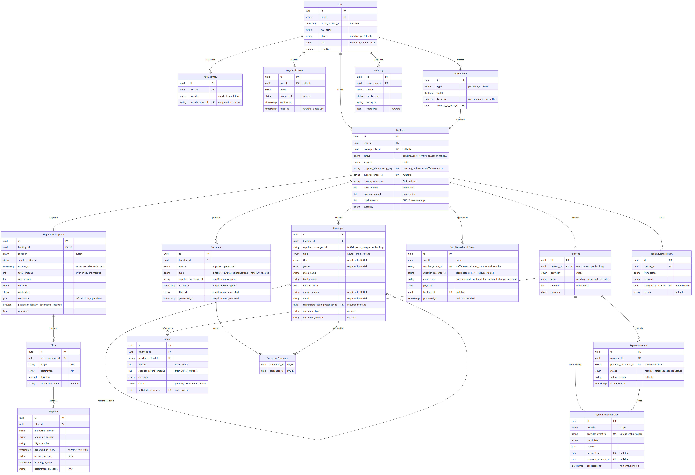
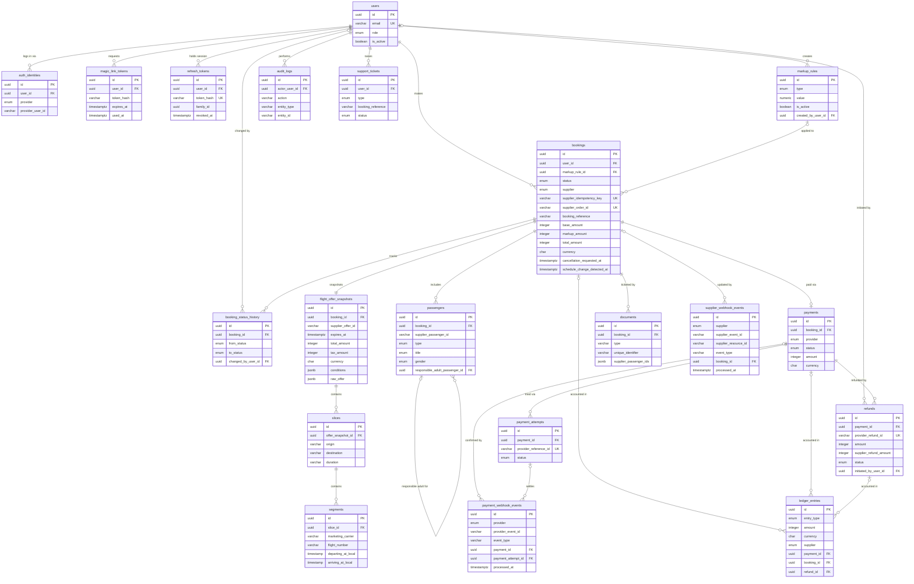

# TravelHub — ERD (Phase 1: Flights Only)

**Status:** Verified against code 2026-10-27 (main @ b176f47)
**Scope:** Direct B2C users booking flights via Duffel, paid through **Paymob**. No hotels, no Travel Company/Agent layer, no wallet — those are Phase 2+ per [archive/prd.md](archive/prd.md).

**Source of truth for this document:** the TypeORM entities (`app/Backend/src/**/*.entity.ts`) and the migrations in `app/Backend/src/database/migrations/` (12 files, `1751600000000-InitAuthTables` → `1758000000000-CreateSupportTicketsTable`). `synchronize` is `false` in both `data-source.ts` and `database.module.ts`, so **the migrations are the real DDL**; entity decorators only describe them. No custom naming strategy is configured — every column name is set explicitly with `name:` in the entity, snake_case by convention. All PKs are `uuid`.

Design decisions driving this schema:

1. **We own a full snapshot of what was booked**, not just a Duffel order ID. Duffel is the airline-side source of truth for the PNR, but our DB is the source of truth for *what the customer was shown and charged*. The snapshot includes the offer's **price, cabin class, and fare conditions**, plus the raw offer payload (`flight_offer_snapshots` → `slices` → `segments`).
2. **Payment is provider-agnostic even though only Paymob is wired up.** A `provider` enum plus a separate `payment_attempts` / `payment_webhook_events` / `refunds` layer. The `payment_provider` enum still contains `stripe` (the original design target) and the `payments.provider` column default is still `'stripe'`, but every code path writes `paymob` — see `Payment` below.
3. **Flight supply is supplier-agnostic too.** A `supplier_provider` enum (one value: `duffel`), an order-creation **idempotency key** we control (Duffel accepts none), and a `supplier_webhook_events` table for Duffel's at-least-once order webhooks.
4. **Auth is passwordless: Google OAuth + email magic link, with rotating refresh tokens.** No `password_hash` on `users` — instead `auth_identities` (provider-agnostic), `magic_link_tokens` for the email flow, and `refresh_tokens` for JWT session rotation with family-based reuse detection.
5. **Contact info lives on the booking flow, not the account.** Duffel requires `phone_number`, `email`, `title` and `gender` **per passenger**. `users.phone` / `users.full_name` are optional prefill only; the required fields live on `passengers`.
6. **Duffel has its own passenger ID namespace.** `passengers.supplier_passenger_id` is the mapping that makes every supplier response (orders, `documents[].passenger_ids`, webhooks) resolvable to our rows.
7. **Documents are Duffel's ticket records only.** `documents` stores what Duffel returns in `order.documents[]` (type, e-ticket number, covered passenger IDs as a JSON array). There is **no** `source` discriminator, no generated-PDF rows, and no `document_passengers` join table — the itinerary/receipt PDF is rendered on demand by `bookings/services/ticket-pdf.service.ts` from booking data, not persisted.
8. **Money is stored as `integer` minor units** (cents, piastres, fils, …) with a `char(3)` ISO 4217 currency column on every money-bearing table. **Phase 1 constraint: a booking, its payment, and its refunds share one currency** — there is no `fx_rate` column anywhere.
9. **Flight times are local wall-clock times, never normalized to UTC.** `segments` stores `timestamp` (without time zone) plus the IANA timezone per endpoint. Every other timestamp in the schema is `timestamptz`.
10. **Operational state is appended, not overwritten.** `booking_status_history`, `audit_logs`, `ledger_entries` and both webhook-event tables are append-only; `support_tickets` is the one customer-facing mutable work queue.

---

## Entities

Column types below are the Postgres types from the migrations. "NN" = `NOT NULL`. FK `ON DELETE` rules are given per column because they differ table to table.

### User — `users`
No password — see `AuthIdentity` / `MagicLinkToken` / `RefreshToken`.
| Column | Type | Notes |
|---|---|---|
| id | uuid PK | `gen_random_uuid()` |
| email | varchar NN, **unique** (`ux_users_email`) | Identity key — Google and magic-link auth both resolve to this |
| email_verified_at | timestamptz, nullable | Set on first successful Google login or magic-link verification |
| full_name | varchar, **nullable** | From Google profile, or collected post-signup for email-link users |
| phone | varchar, nullable | Convenience prefill only — never the source of truth for a booking's contact info |
| role | enum `user_role` NN, default `'user'` | Values: `technical_admin`, `user` |
| is_active | boolean NN, default `true` | |
| created_at / updated_at | timestamptz NN, default `now()` | |

### AuthIdentity — `auth_identities`
One row per login method a user has used. Identity rows *are* the credentials in a passwordless system, so uniqueness is enforced hard:
- **`ux_auth_identities_provider_user`** — partial unique index on (`provider`, `provider_user_id`) `WHERE provider_user_id IS NOT NULL` — one Google `sub` can never map to two users.
- **`ux_auth_identities_user_provider`** — UNIQUE (`user_id`, `provider`) — one identity row per method per user.

| Column | Type | Notes |
|---|---|---|
| id | uuid PK | |
| user_id | uuid NN, FK → users **ON DELETE CASCADE** (`fk_auth_identities_user`) | |
| provider | enum `auth_provider` NN | Values: `google`, `email_link` |
| provider_user_id | varchar, nullable | Google's stable `sub` claim; null for `email_link` |
| created_at | timestamptz NN | |

### MagicLinkToken — `magic_link_tokens`
| Column | Type | Notes |
|---|---|---|
| id | uuid PK | |
| user_id | uuid, nullable, FK → users **ON DELETE CASCADE** (`fk_magic_link_tokens_user`) | Null until the email is confirmed to belong to an existing/new user |
| email | varchar NN | What the link was requested for |
| token_hash | varchar NN, **indexed** (`ix_magic_link_tokens_token_hash`, non-unique) | SHA-256 of the raw token; the raw token is never stored |
| expires_at | timestamptz NN | |
| used_at | timestamptz, nullable | Single-use — verification is an atomic `UPDATE … WHERE used_at IS NULL` |
| requested_ip | varchar, nullable | Abuse/rate-limit signal |
| created_at | timestamptz NN | |

### RefreshToken — `refresh_tokens`
JWT refresh-token rotation (auth_flow.md §4). Tokens are grouped into a **family**; presenting a revoked token from a family revokes the whole family (theft detection).
| Column | Type | Notes |
|---|---|---|
| id | uuid PK | |
| user_id | uuid NN, FK → users **ON DELETE CASCADE** (`fk_refresh_tokens_user`) | |
| token_hash | varchar NN, **unique** (`ux_refresh_tokens_token_hash`) | SHA-256 of the raw opaque token |
| family_id | uuid NN, **indexed** (`ix_refresh_tokens_family_id`) | Rotation chain id — the revoke-all-in-family lookup |
| expires_at | timestamptz NN | |
| revoked_at | timestamptz, nullable | Set on rotation or explicit revoke |
| user_agent | varchar, nullable | |
| ip | varchar, nullable | |
| created_at | timestamptz NN | |

### MarkupRule — `markup_rules`
Admin-configurable markup. `percentage` applies to `bookings.base_amount` once per booking; `fixed` is a minor-unit amount in the booking currency.

**Constraint:** `ux_markup_rules_active_one` — partial unique index on `is_active WHERE is_active = true` — at most one active rule, enforced by the database.

| Column | Type | Notes |
|---|---|---|
| id | uuid PK | |
| type | enum `markup_type` NN | Values: `percentage`, `fixed` |
| value | numeric(10,3) NN | Percentage (e.g. `2.500`) or minor-unit amount for `fixed`. TypeORM surfaces it as a string |
| is_active | boolean NN, default `false` | Partial unique index: at most one row where true |
| created_by_user_id | uuid NN, FK → users **ON DELETE RESTRICT** (`fk_markup_rules_created_by`) | |
| created_at / updated_at | timestamptz NN | |

### Booking — `bookings`
The commercial record — one per flight purchase.

**Invariants:**
- CHECK `ck_bookings_total_match`: `total_amount = base_amount + markup_amount`.
- `supplier_idempotency_key` is generated **before** the first supplier order-creation call and reused on every retry; Duffel accepts no client idempotency key, so it is echoed into the Duffel order `metadata` for post-timeout reconciliation.
- `ux_bookings_supplier_order_id` — UNIQUE on nullable `supplier_order_id` — the database refuses a second booking claiming the same Duffel order.

| Column | Type | Notes |
|---|---|---|
| id | uuid PK | |
| user_id | uuid NN, FK → users **ON DELETE RESTRICT** (`fk_bookings_user`) | Indexed with `created_at DESC` (`ix_bookings_user_created`) for the my-bookings list |
| markup_rule_id | uuid, nullable, FK → markup_rules **ON DELETE SET NULL** (`fk_bookings_markup_rule`) | Which rule was applied at booking time |
| status | enum `booking_status` NN, default `'pending'` | Values: `pending`, `awaiting_payment`, `paid`, `confirmed`, `order_failed`, `cancelled`, `failed`, `refunded`. `paid` = money captured, supplier order in flight; `order_failed` = money captured but supplier order creation definitively failed (refund path). Transitions in [booking_state_machine.md](booking_state_machine.md) |
| supplier | enum `supplier_provider` NN, default `'duffel'` | Values: `duffel` |
| supplier_idempotency_key | varchar NN, **unique** (`ux_bookings_supplier_idempotency_key`) | Ours only |
| supplier_order_id | varchar, nullable, **unique** (`ux_bookings_supplier_order_id`) | Set once the supplier's order creation succeeds (`ord_…`) |
| booking_reference | varchar, nullable, indexed (`ix_bookings_booking_reference`) | Airline PNR — support looks bookings up by this |
| base_amount | integer NN (minor units) | What Duffel charges us |
| markup_amount | integer NN (minor units) | Computed from MarkupRule at booking time |
| total_amount | integer NN (minor units) | What the customer pays; CHECK = base + markup |
| currency | char(3) NN | ISO 4217 — one currency per booking |
| cancellation_requested_at | timestamptz, nullable | Set when a non-auto-approvable cancellation is routed to `technical_admin` (migration `1754…`). Partial index `ix_bookings_cancellation_requested WHERE cancellation_requested_at IS NOT NULL` feeds the admin queue |
| cancellation_request_reason | varchar, nullable | Customer's stated reason |
| schedule_change_detected_at | timestamptz, nullable | Set when Duffel reports `order.airline_initiated_change_detected` (migration `1755…`) |
| created_at / updated_at | timestamptz NN | |

### FlightOfferSnapshot — `flight_offer_snapshots` (1:1 with Booking)
Frozen copy of the supplier's offer at the moment of booking.
| Column | Type | Notes |
|---|---|---|
| id | uuid PK | |
| booking_id | uuid NN, FK → bookings **ON DELETE CASCADE** (`fk_flight_offer_snapshots_booking`), **unique** (`ux_flight_offer_snapshots_booking_id`) | |
| supplier | enum `supplier_provider` NN | Matches `bookings.supplier` (no default here) |
| supplier_offer_id | varchar NN | Duffel `off_…` |
| expires_at | timestamptz NN | Supplier's own offer expiry — no fixed window |
| owner_airline_name / owner_airline_iata | varchar NN | |
| total_amount / tax_amount | integer NN (minor units) | The offer's own price breakdown, pre-markup — what Duffel quoted |
| currency | char(3) NN | |
| cabin_class | varchar NN | e.g. `economy` |
| conditions | jsonb NN | Duffel's `conditions` (`refund_before_departure`, `change_before_departure` + penalties) |
| passenger_identity_documents_required | boolean NN, default `false` | Drives whether checkout must collect passport/ID fields |
| raw_offer | jsonb NN | The full offer payload as returned |
| captured_at | timestamptz NN, default `now()` | Create-date column |

### Slice — `slices` (offer snapshot → slices)
No timestamps on this table.
| Column | Type | Notes |
|---|---|---|
| id | uuid PK | |
| offer_snapshot_id | uuid NN, FK → flight_offer_snapshots **ON DELETE CASCADE** (`fk_slices_offer_snapshot`) | |
| origin / destination | varchar(3) NN | IATA |
| duration | varchar NN | ISO 8601 duration string as Duffel returns it |
| fare_brand_name | varchar, nullable | |

### Segment — `segments` (slice → segments)
Times are **local wall-clock, stored without UTC conversion** (`timestamp` without time zone), each paired with its IANA timezone. No timestamps-of-record on this table.
| Column | Type | Notes |
|---|---|---|
| id | uuid PK | |
| slice_id | uuid NN, FK → slices **ON DELETE CASCADE** (`fk_segments_slice`) | |
| marketing_carrier / operating_carrier | varchar(2) NN | IATA airline codes; codeshare distinction |
| flight_number | varchar NN | |
| aircraft | varchar, nullable | |
| departing_at_local | timestamp (no tz) NN | Local time at origin |
| origin_timezone | varchar NN | IANA, e.g. `Africa/Cairo` |
| arriving_at_local | timestamp (no tz) NN | Local time at destination |
| destination_timezone | varchar NN | IANA |
| origin_terminal / destination_terminal | varchar, nullable | |

### Passenger — `passengers`
Everything Duffel hard-requires to create an order lives here. No `created_at` / `updated_at` on this table.

**Constraints:**
- `ux_passengers_booking_supplier_pax` — partial unique index on (`booking_id`, `supplier_passenger_id`) `WHERE supplier_passenger_id IS NOT NULL`.
- CHECK `ck_passengers_infant_adult`: `type != 'infant' OR responsible_adult_passenger_id IS NOT NULL`.

| Column | Type | Notes |
|---|---|---|
| id | uuid PK | |
| booking_id | uuid NN, FK → bookings **ON DELETE CASCADE** (`fk_passengers_booking`) | |
| supplier_passenger_id | varchar, nullable | Duffel's passenger ID (`pas_…`); null until known |
| type | enum `passenger_type` NN | Values: `adult`, `child`, `infant` |
| title | enum `passenger_title` NN | Values: `mr`, `ms`, `mrs`, `miss` |
| gender | enum `passenger_gender` NN | Values: `m`, `f` |
| given_name / family_name | varchar NN | |
| date_of_birth | date NN | TypeORM surfaces it as `YYYY-MM-DD` string |
| phone_number | varchar NN | Required by Duffel per passenger |
| email | varchar NN | Required by Duffel per passenger |
| responsible_adult_passenger_id | uuid, nullable, FK → passengers **ON DELETE SET NULL** (`fk_passengers_responsible_adult`) | Required when `type = infant` (CHECK above) |
| document_type | varchar, nullable | passport / national_id etc. — only when `flight_offer_snapshots.passenger_identity_documents_required` |
| document_number | varchar, nullable | |
| document_expiry | date, nullable | |
| nationality | varchar, nullable | |

### Payment — `payments` (0..1 per Booking)
Current state of money for a booking. A `pending` booking has **no payment row yet** — the row is created inside the checkout transaction when the pay step is reached (`payments.service.ts`), with `amount = bookings.total_amount` and `currency = bookings.currency` (application-enforced).

> Note: the `payment_provider` enum is `('stripe', 'paymob')` and the column default is `'stripe'` (migration `1751900000000`), but `payments.service.ts` always sets `provider = 'paymob'` explicitly and the webhook controller only accepts Paymob. `stripe` is a residual value from the original design; no code path writes it.

| Column | Type | Notes |
|---|---|---|
| id | uuid PK | |
| booking_id | uuid NN, FK → bookings **ON DELETE RESTRICT** (`fk_payments_booking`), **unique** (`ux_payments_booking_id`) | One payment per booking, by the database |
| provider | enum `payment_provider` NN, default `'stripe'` | Values: `stripe`, `paymob` — see Note |
| status | enum `payment_status` NN, default `'pending'` | Values: `pending`, `succeeded`, `failed`, `refunded`, `partially_refunded`. Refund *details* live in `refunds` — this is the rollup |
| amount | integer NN (minor units) | = `bookings.total_amount` at creation |
| currency | char(3) NN | = `bookings.currency` |
| created_at / updated_at | timestamptz NN | |

### PaymentAttempt — `payment_attempts` (Payment → attempts)
Where the gateway integration logic lives — retries, failures, 3DS. `provider_reference_id` is the key webhooks match on.
| Column | Type | Notes |
|---|---|---|
| id | uuid PK | |
| payment_id | uuid NN, FK → payments **ON DELETE CASCADE** (`fk_payment_attempts_payment`) | |
| provider_reference_id | varchar NN, **unique** (`ux_payment_attempts_provider_ref`) | Paymob order / transaction reference. Also has a redundant non-unique index `ix_payment_attempts_provider_ref` (both the entity and migration create it alongside the UNIQUE constraint) |
| status | enum `payment_attempt_status` NN | Values: `requires_action`, `processing`, `succeeded`, `failed` |
| failure_reason | varchar, nullable | |
| method | varchar, nullable | card / wallet / etc. |
| attempted_at | timestamptz NN, default `now()` | Create-date column |

### PaymentWebhookEvent — `payment_webhook_events`
Inbound events from the gateway — dedupe + audit trail. Dedupe is **UNIQUE (`provider`, `provider_event_id`)** (`ux_payment_webhook_events_provider_event`).

> Note: Paymob has no distinct event id. `webhooks.controller.ts` synthesises `provider_event_id = "<transaction.id>:<event_type>"` and `event_type` is one of `transaction.pending`, `transaction.succeeded`, `transaction.failed` — so exact redeliveries collapse while state progressions for the same transaction are kept. Processing happens in a BullMQ worker; `processed_at` is set when the worker finishes.

| Column | Type | Notes |
|---|---|---|
| id | uuid PK | |
| provider | enum `payment_provider` NN | Code only writes `paymob` |
| provider_event_id | varchar NN | Unique together with `provider` |
| event_type | varchar NN | See Note |
| payload | jsonb NN | Raw event body |
| payment_id | uuid, nullable, FK → payments **ON DELETE SET NULL** (`fk_payment_webhook_events_payment`) | Resolved after matching |
| payment_attempt_id | uuid, nullable, FK → payment_attempts **ON DELETE SET NULL** (`fk_payment_webhook_events_payment_attempt`) | Which *attempt* the event settles |
| received_at | timestamptz NN, default `now()` | Create-date column |
| processed_at | timestamptz, nullable | Partial index `ix_payment_webhook_events_unprocessed WHERE processed_at IS NULL` for the reprocessing worker |

### Refund — `refunds`
`refunded` / `partially_refunded` on `payments` are rollups; this is the record behind them. Rows are created as `pending` **before** the gateway call (migration `1756000000000` made `provider_refund_id` nullable for exactly this reason).
| Column | Type | Notes |
|---|---|---|
| id | uuid PK | |
| payment_id | uuid NN, FK → payments **ON DELETE RESTRICT** (`fk_refunds_payment`) | |
| provider_refund_id | varchar, nullable, **unique** (`ux_refunds_provider_refund_id`) | Paymob refund id — assigned only once the gateway accepts; null while `pending` / `failed` (Postgres allows multiple NULLs under UNIQUE) |
| amount | integer NN (minor units) | What we return to the customer |
| currency | char(3) NN | = booking currency |
| supplier_refund_amount | integer, nullable (minor units) | What Duffel refunded **us** on cancellation — airline-determined, often less than the customer paid |
| status | enum `refund_status` NN, default `'pending'` | Values: `pending`, `succeeded`, `failed` |
| reason | varchar, nullable | |
| initiated_by_user_id | uuid, nullable, FK → users **ON DELETE SET NULL** (`fk_refunds_user`) | null = system-triggered |
| created_at / updated_at | timestamptz NN | |

### SupplierWebhookEvent — `supplier_webhook_events`
The supplier-side twin of `PaymentWebhookEvent`. Duffel delivers order lifecycle events at-least-once, unordered, retried up to 72h. The processor (`bookings/queues/duffel-webhook.processor.ts`) handles `ping.triggered`, `order.created`, `order.airline_initiated_change_detected`.

**Dedup:** UNIQUE (`supplier`, `supplier_event_id`) (`ux_supplier_webhook_events_supplier_event`) on Duffel's event `id` (`wev_…`). `supplier_resource_id` is Duffel's `idempotency_key`, which is the **related resource's id** (`ord_…`), not a per-event key — used only to resolve the booking.
| Column | Type | Notes |
|---|---|---|
| id | uuid PK | |
| supplier | enum `supplier_provider` NN, default `'duffel'` | |
| supplier_event_id | varchar NN | Duffel's event `id` — unique together with `supplier` |
| supplier_resource_id | varchar, nullable, indexed (`ix_supplier_webhook_events_resource`) | Duffel's `idempotency_key` = related resource id |
| event_type | varchar NN | |
| payload | jsonb NN | Raw event body |
| booking_id | uuid, nullable, FK → bookings **ON DELETE SET NULL** (`fk_supplier_webhook_events_booking`) | Resolved by matching `supplier_resource_id` → `bookings.supplier_order_id` |
| received_at | timestamptz NN, default `now()` | Create-date column |
| processed_at | timestamptz, nullable | Partial index `ix_supplier_webhook_events_unprocessed WHERE processed_at IS NULL` |

### Document — `documents`
Duffel's ticket records, copied from `order.documents[]` on fulfilment (`fulfillment-outcome.service.ts`). One row per Duffel document; a document can cover several passengers, held as a JSON array of **Duffel** passenger ids that resolve to `passengers.supplier_passenger_id`. There is no `source` discriminator and no join table; generated PDFs are not stored.
| Column | Type | Notes |
|---|---|---|
| id | uuid PK | `uuid_generate_v4()` (see Note under Constraints) |
| booking_id | uuid NN, FK → bookings **ON DELETE CASCADE** (`fk_documents_booking`), indexed (`ix_documents_booking_id`) | |
| type | varchar NN | Duffel's `documents[].type` as a free string — e.g. `electronic_ticket`, `electronic_miscellaneous_document_associated`. Not an enum |
| unique_identifier | varchar NN | Duffel's `unique_identifier` — the e-ticket number. Not unique at the DB level |
| supplier_passenger_ids | jsonb NN, default `'[]'` | Array of Duffel passenger ids (`pas_…`) this document covers |
| created_at | timestamptz NN | |

### BookingStatusHistory — `booking_status_history`
Audit trail for the booking state machine. No indexes beyond the PK.
| Column | Type | Notes |
|---|---|---|
| id | uuid PK | |
| booking_id | uuid NN, FK → bookings **ON DELETE CASCADE** (`fk_booking_status_history_booking`) | |
| from_status / to_status | enum `booking_status` NN | |
| changed_by_user_id | uuid, nullable, FK → users **ON DELETE SET NULL** (`fk_booking_status_history_user`) | null = system-triggered (webhook, worker) |
| reason | varchar, nullable | e.g. `offer_expired` |
| created_at | timestamptz NN | |

### AuditLog — `audit_logs`
Generic admin-action trail.
| Column | Type | Notes |
|---|---|---|
| id | uuid PK | `uuid_generate_v4()` |
| actor_user_id | uuid NN, FK → users **ON DELETE RESTRICT** (`fk_audit_logs_user`) | Indexed with `created_at DESC` (`ix_audit_logs_actor_created`) |
| action | varchar NN | e.g. `markup_rule.updated` |
| entity_type / entity_id | varchar NN | Polymorphic reference |
| metadata | jsonb, nullable | Before/after values |
| created_at | timestamptz NN | |

### LedgerEntry — `ledger_entries`
Append-only internal money-movement ledger — substitutes for Duffel's missing balance API. `LedgerService.createEntry` takes the caller's `EntityManager`, so entries are written **inside the same DB transaction** as the lifecycle event they record. Migration `1757000000000` backfilled entries from existing payments, refunds and confirmed bookings.
| Column | Type | Notes |
|---|---|---|
| id | uuid PK | |
| entry_type | enum `ledger_entry_type` NN | Values: `customer_payment` (+), `gateway_refund` (−), `supplier_charge` (−), `supplier_refund` (+), `adjustment` (±) |
| amount | integer NN | **Signed** minor units; sign encodes direction |
| currency | char(3) NN | |
| supplier | enum `supplier_provider`, nullable | Set on supplier-wallet movements (`duffel`); NULL on gateway-side entries |
| payment_id | uuid, nullable, FK → payments **ON DELETE SET NULL** (`fk_ledger_entries_payment`) | |
| booking_id | uuid, nullable, FK → bookings **ON DELETE SET NULL** (`fk_ledger_entries_booking`), indexed (`ix_ledger_entries_booking`) | |
| refund_id | uuid, nullable, FK → refunds **ON DELETE SET NULL** (`fk_ledger_entries_refund`) | |
| note | varchar, nullable | |
| created_at | timestamptz NN, indexed (`ix_ledger_entries_created_at`) | |

### SupportTicket — `support_tickets`
Customer-raised support requests, worked by `technical_admin`.
| Column | Type | Notes |
|---|---|---|
| id | uuid PK | `uuid_generate_v4()` |
| user_id | uuid NN, FK → users **ON DELETE CASCADE** (`fk_support_tickets_user`) | Indexed with `created_at DESC` (`ix_support_tickets_user_created`) |
| type | enum `support_ticket_type` NN | Values: `cancellation`, `flight_delay`, `name_change`, `refund`, `other` |
| booking_reference | varchar, nullable | Free-text PNR as entered by the customer — **deliberately not an FK**: users may cite bookings made under another account or mistype; admins resolve it manually |
| description | text NN | |
| status | enum `support_ticket_status` NN, default `'open'` | Values: `open`, `in_progress`, `resolved`. Indexed with `created_at DESC` (`ix_support_tickets_status_created`) for the admin queue |
| admin_note | text, nullable | Visible to the customer as the support team's reply |
| created_at / updated_at | timestamptz NN | |

---

## Enum types (Postgres)

| Type | Values | Used by |
|---|---|---|
| `user_role` | `technical_admin`, `user` | users.role |
| `auth_provider` | `google`, `email_link` | auth_identities.provider |
| `markup_type` | `percentage`, `fixed` | markup_rules.type |
| `booking_status` | `pending`, `awaiting_payment`, `paid`, `confirmed`, `order_failed`, `cancelled`, `failed`, `refunded` | bookings.status, booking_status_history.from_status / to_status |
| `supplier_provider` | `duffel` | bookings, flight_offer_snapshots, supplier_webhook_events, ledger_entries |
| `passenger_type` | `adult`, `child`, `infant` | passengers.type |
| `passenger_title` | `mr`, `ms`, `mrs`, `miss` | passengers.title |
| `passenger_gender` | `m`, `f` | passengers.gender |
| `payment_provider` | `stripe`, `paymob` | payments.provider, payment_webhook_events.provider |
| `payment_status` | `pending`, `succeeded`, `failed`, `refunded`, `partially_refunded` | payments.status |
| `payment_attempt_status` | `requires_action`, `processing`, `succeeded`, `failed` | payment_attempts.status |
| `refund_status` | `pending`, `succeeded`, `failed` | refunds.status |
| `ledger_entry_type` | `customer_payment`, `gateway_refund`, `supplier_charge`, `supplier_refund`, `adjustment` | ledger_entries.entry_type |
| `support_ticket_type` | `cancellation`, `flight_delay`, `name_change`, `refund`, `other` | support_tickets.type |
| `support_ticket_status` | `open`, `in_progress`, `resolved` | support_tickets.status |

---

## Constraints & Indexes (consolidated)

Uniqueness that prevents corruption:
- `users.email` — `ux_users_email`
- `auth_identities` — `ux_auth_identities_provider_user` partial unique (`provider`, `provider_user_id`) `WHERE provider_user_id IS NOT NULL`; `ux_auth_identities_user_provider` UNIQUE (`user_id`, `provider`)
- `refresh_tokens.token_hash` — `ux_refresh_tokens_token_hash`
- `markup_rules` — `ux_markup_rules_active_one` partial unique on `is_active WHERE is_active = true`
- `bookings.supplier_idempotency_key` — `ux_bookings_supplier_idempotency_key`; `bookings.supplier_order_id` — `ux_bookings_supplier_order_id` (nullable)
- `flight_offer_snapshots.booking_id` — `ux_flight_offer_snapshots_booking_id`
- `passengers` — `ux_passengers_booking_supplier_pax` partial unique (`booking_id`, `supplier_passenger_id`) `WHERE supplier_passenger_id IS NOT NULL`
- `payments.booking_id` — `ux_payments_booking_id`
- `payment_attempts.provider_reference_id` — `ux_payment_attempts_provider_ref`
- `payment_webhook_events` — `ux_payment_webhook_events_provider_event` (`provider`, `provider_event_id`)
- `refunds.provider_refund_id` — `ux_refunds_provider_refund_id` (nullable)
- `supplier_webhook_events` — `ux_supplier_webhook_events_supplier_event` (`supplier`, `supplier_event_id`)

CHECKs:
- `bookings` — `ck_bookings_total_match`: `total_amount = base_amount + markup_amount`
- `passengers` — `ck_passengers_infant_adult`: `type != 'infant' OR responsible_adult_passenger_id IS NOT NULL`

No other CHECK constraints exist (in particular, nothing on `documents`).

Access-pattern indexes:
- `bookings (user_id, created_at DESC)` — `ix_bookings_user_created` — my-bookings list
- `bookings (booking_reference)` — `ix_bookings_booking_reference` — support lookup by PNR
- `bookings (cancellation_requested_at) WHERE cancellation_requested_at IS NOT NULL` — `ix_bookings_cancellation_requested` — admin cancellation queue
- `magic_link_tokens (token_hash)` — `ix_magic_link_tokens_token_hash`
- `refresh_tokens (family_id)` — `ix_refresh_tokens_family_id`
- `payment_attempts (provider_reference_id)` — `ix_payment_attempts_provider_ref` (redundant with the UNIQUE constraint)
- `payment_webhook_events (processed_at) WHERE processed_at IS NULL` — `ix_payment_webhook_events_unprocessed`
- `supplier_webhook_events (supplier_resource_id)` — `ix_supplier_webhook_events_resource`; `(processed_at) WHERE processed_at IS NULL` — `ix_supplier_webhook_events_unprocessed`
- `documents (booking_id)` — `ix_documents_booking_id`
- `audit_logs (actor_user_id, created_at DESC)` — `ix_audit_logs_actor_created`
- `ledger_entries (created_at)` — `ix_ledger_entries_created_at`; `(booking_id)` — `ix_ledger_entries_booking`
- `support_tickets (user_id, created_at DESC)` — `ix_support_tickets_user_created`; `(status, created_at DESC)` — `ix_support_tickets_status_created`

FK `ON DELETE` summary:
- **CASCADE** from `users`: auth_identities, magic_link_tokens, refresh_tokens, support_tickets. From `bookings`: flight_offer_snapshots, passengers, booking_status_history, documents. From `flight_offer_snapshots`: slices. From `slices`: segments. From `payments`: payment_attempts.
- **RESTRICT**: bookings.user_id, markup_rules.created_by_user_id, audit_logs.actor_user_id, payments.booking_id, refunds.payment_id — a user with bookings, a booking with a payment, or a payment with refunds cannot be hard-deleted.
- **SET NULL**: bookings.markup_rule_id, passengers.responsible_adult_passenger_id, booking_status_history.changed_by_user_id, refunds.initiated_by_user_id, payment_webhook_events.payment_id / payment_attempt_id, supplier_webhook_events.booking_id, ledger_entries.payment_id / booking_id / refund_id.

> Note: entity decorators and migrations disagree in two cosmetic places. (1) The entity `@Index` for `ix_bookings_user_created`, `ix_audit_logs_actor_created`, `ix_support_tickets_user_created` and `ix_support_tickets_status_created` does not express the `DESC` ordering the migrations create; since `synchronize` is off, the migration's `DESC` is what exists. (2) `flight_offer_snapshots.booking_id` uniqueness is a named constraint in the migration (`ux_flight_offer_snapshots_booking_id`) but only implied by `@OneToOne` + `@JoinColumn` in the entity.

> Note: PK defaults are inconsistent across migrations. `documents`, `audit_logs` and `support_tickets` use `uuid_generate_v4()` (requires the `uuid-ossp` extension), while every other table uses the built-in `gen_random_uuid()`. No migration, compose file or SQL script in the repo runs `CREATE EXTENSION "uuid-ossp"`, so the extension must already exist on the target database; a fresh Postgres without it would fail at migration `1752000000000`.

---

## Relationships

Legacy diagram image (pre-dates `refresh_tokens`, `support_tickets` and the `documents` simplification): [erd.png](erd.png)

Cardinality notes:
- `bookings → payments` is **0..1**, not 1:1 — a `pending` booking has no payment row yet.
- `payment_webhook_events.payment_id` / `payment_attempt_id` and `supplier_webhook_events.booking_id` are nullable: unmatched events are stored first, resolved after.
- `support_tickets.booking_reference` is free text, not an FK — it is drawn only as a user relation.
- `documents.supplier_passenger_ids` references passengers by Duffel id inside JSON; there is no FK, so the diagram shows no edge to `passengers`.

---

## Deliberately Excluded (Phase 2+)

- `TravelCompany`, `TravelAgent`, `Wallet`, `WalletTransaction`, `CommissionRule` — B2B layer, per [archive/prd.md](archive/prd.md) Phase 2.
- `Accommodation` / `Room` / `Rate` / hotel-side entities — flights-only for now.
- Cross-currency money (`fx_rate`, `quoted_at`) — not modeled; additive to the minor-units model.
- A `document_passengers` join table and a `source`/`file_url` document model — the earlier draft's design; the shipped `documents` table holds Duffel ticket records only, with covered passengers as a JSON array.
- Provider-specific tables for a second gateway or a second flight supplier — the `provider` / `supplier` enums plus the adapter-shaped tables already accommodate them.
- Apple/Facebook/other OAuth providers — `auth_identities.provider` accommodates them the same way.

---

## Next

This feeds the **[Booking/Payment state machine](booking_state_machine.md)** (transition rules for the `status` enums above), the **[sequence diagrams](sequence_diagrams.md)** (race-prone flows), and the **[API contract](api_contract.md)** (each entity here maps to request/response shapes). See also [auth_flow.md](auth_flow.md) and [nfr.md](nfr.md).
