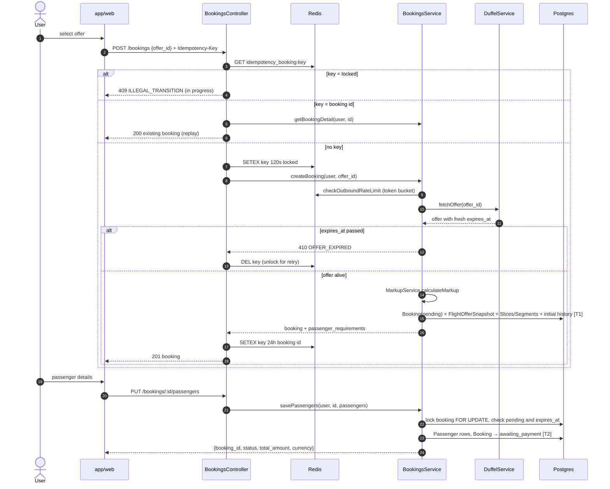
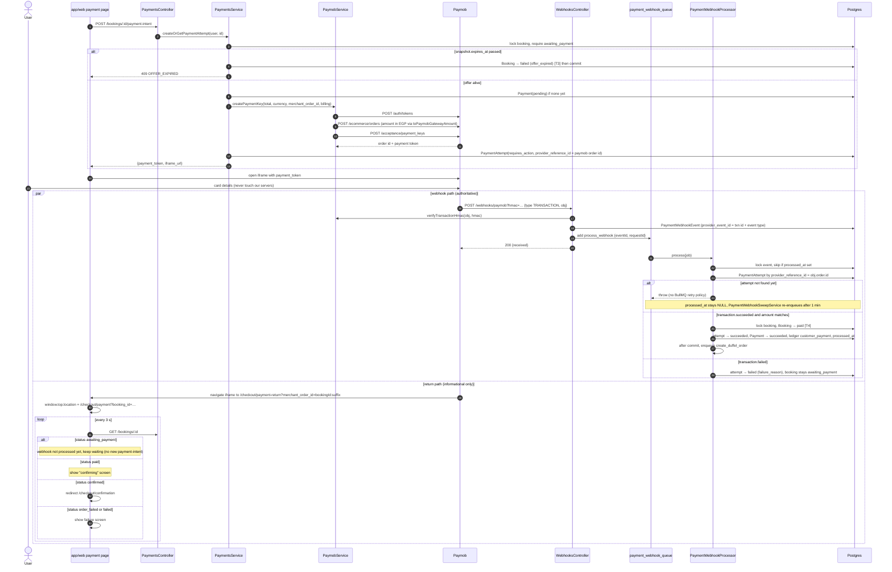
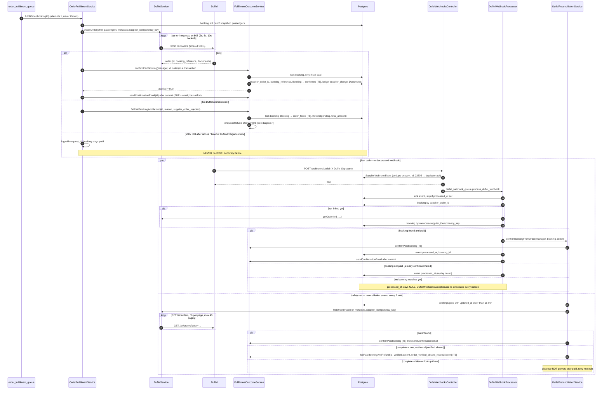
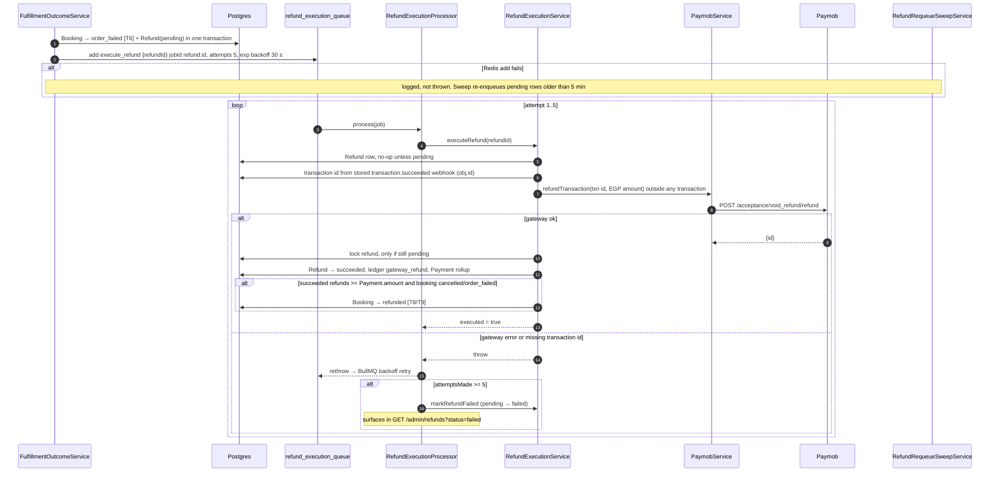
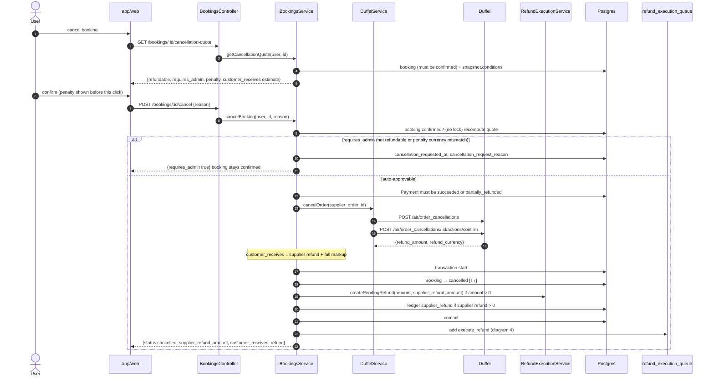
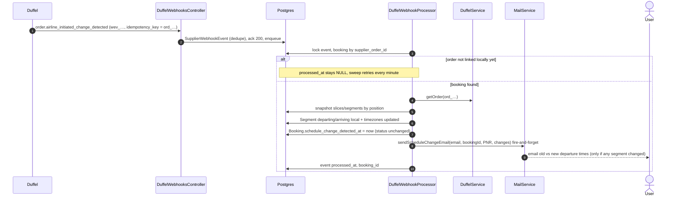

# TravelHub — Sequence Diagrams (Race-Prone Flows)

**Status:** Verified against code 2026-10-27 (main @ b176f47)
**Inputs:** [booking_state_machine.md](booking_state_machine.md) (transition numbers T1–T9 referenced below), [erd.md](erd.md), [duffel_api_integration_guide.md](duffel_api_integration_guide.md), [archive/prd.md](archive/prd.md) §5.3–5.5.

These diagrams cover the paths where ordering and failure matter, as the backend implements them today. Participant names are the real NestJS classes under `app/Backend/src/`; messages name the real methods and endpoints. The gateway is **Paymob**, the supplier is **Duffel**.

---

## 1. Create booking with idempotency (T1)

Without an `Idempotency-Key` header the controller calls `createBooking` directly and a double-click creates two `pending` bookings. `savePassengers` returns a vestigial `client_secret: pi_mock_…` field that nothing consumes.

---

## 2. Pay via Paymob — intent → iframe → return page → webhook

The return page carries no outcome and sets no state. If the user lands back before the webhook has been processed, the booking still reads `awaiting_payment` and the page simply keeps polling. If the webhook arrives before `PaymentAttempt` is committed, the processor throws and the sweep replays the event a minute later. A `transaction.pending` callback (3DS in flight) is stored, acked and marked processed without touching the attempt.

Retry after a decline: the user calls `POST /bookings/:id/payment-intent` again while still `awaiting_payment`; a **new** attempt with a fresh Paymob order (`merchant_order_id` suffix) is created; the failed attempt is never mutated.

---

## 3. Order fulfillment — job → createOrder → order.created fast path vs reconciliation sweep

Whichever of the three paths locks the booking first applies T5; the others find it no longer `paid`, return `false`, and send no email. The sync `createOrder` response landing **after** the webhook already confirmed is therefore a no-op, not a conflict.

---

## 4. Order failed → refund enqueue → refund execution with attempts

Admin paths reuse the same service: `POST /admin/payments/:id/refund` creates the `pending` row then calls `executeRefund` inline (marking the row `failed` on a throw); `POST /admin/refunds/:id/retry` flips `failed → pending` and re-enqueues with the same job options. Because `jobId` is derived from the refund id, the sweep and the retry endpoint are no-ops while a job is still live or delayed.

---

## 5. User cancellation with quote (T7)

The `cancelled` state and the `pending` `Refund` row commit together, so a gateway outage can never lose the obligation to refund. A cancellation with an airline penalty leaves the payment `partially_refunded` and the booking in `cancelled` permanently — T8 only fires when succeeded refunds cover the full `Payment.amount`. Admin cancellation (`AdminService.cancelBooking`) follows the same sequence with `changed_by_user_id = admin`, an `AuditLog` row, and no payment pre-check (a non-refundable payment skips the refund row with a warning). No email is sent on cancellation or refund.

---

## 6. Airline schedule change (post-booking supplier event)

Segments are matched by slice/segment position, not by id. Accept/rebook handling is manual via `technical_admin` (the booking status does not change; `schedule_change_detected_at` is exposed on the booking payload).
